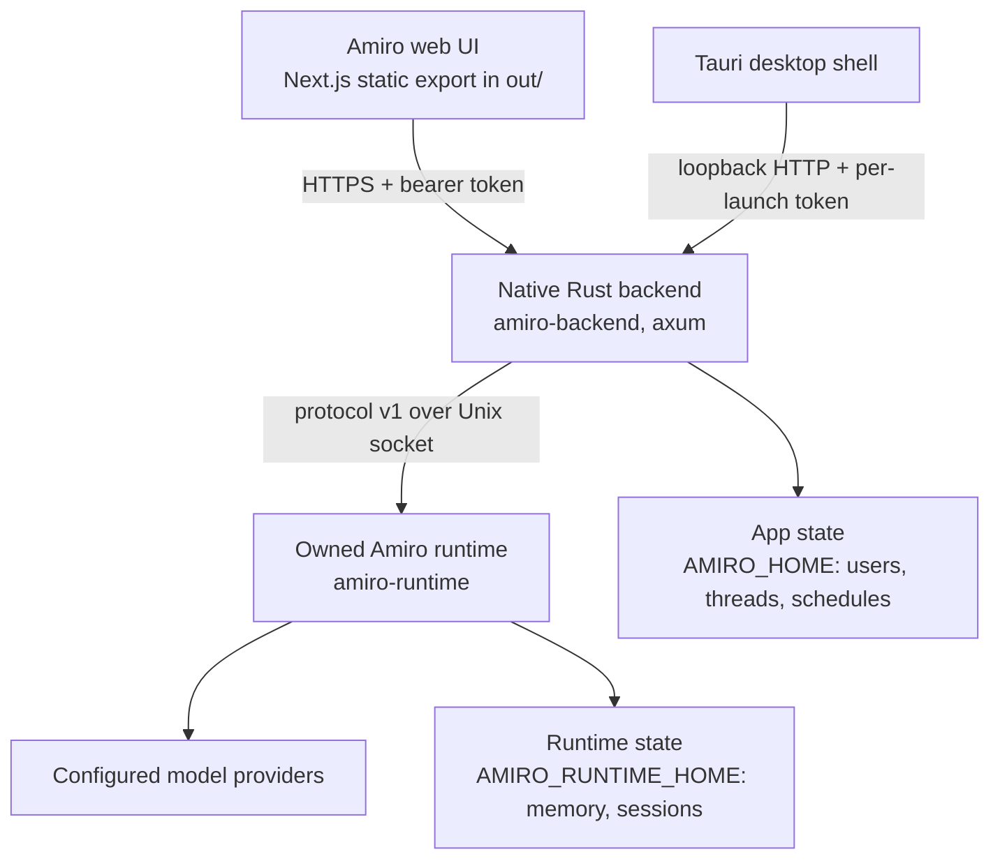

<div align="center">

# Amiro

**A personal-intelligence chat app you can actually own: a native Rust backend, a vendored Rust agent runtime, and a Tauri desktop shell around a statically-exported Next.js UI.**

[](https://github.com/vallabha717/Amiro/actions/workflows/ci.yml)
[](LICENSE)
[](https://nodejs.org)
[](https://rustup.rs)
[](https://pnpm.io)
[](https://tauri.app)
[](https://nextjs.org)

</div>

---

## Install

**Server / VM (Linux, macOS):**

```bash
curl -fsSL https://github.com/vallabha717/Amiro/releases/latest/download/install.sh | bash
```

Add `-s -- --public --service` to reach it over the network and keep it
running across reboots. **Desktop app:** download the installer for macOS,
Windows or Linux from the [latest release](https://github.com/vallabha717/Amiro/releases/latest).
Either way, the first launch opens a setup wizard; see [docs/SETUP.md](docs/SETUP.md).


## Table of contents

- [What Amiro is](#what-amiro-is)
- [Features](#features)
- [Architecture](#architecture)
- [Requirements](#requirements)
- [Setup on a fresh VM or machine](#setup-on-a-fresh-vm-or-machine)
  - [Fast path: one command](#fast-path-one-command)
  - [Manual path: Ubuntu / Debian](#manual-path-ubuntu--debian)
  - [Manual path: macOS](#manual-path-macos)
  - [WSL2](#wsl2)
  - [Headless server (no display)](#headless-server-no-display)
  - [First sign-in](#first-sign-in)
- [Running Amiro](#running-amiro)
- [Configuration](#configuration)
- [The `amiro` CLI](#the-amiro-cli)
- [Testing and verification](#testing-and-verification)
- [What works today, and what does not](#what-works-today-and-what-does-not)
- [Project layout](#project-layout)
- [Troubleshooting](#troubleshooting)
- [Documentation](#documentation)
- [Contributing](#contributing)
- [Security](#security)
- [License and acknowledgements](#license-and-acknowledgements)

---

## What Amiro is

Amiro is a self-hostable chat product built from four parts that all live in this
repository:

| Part | Path | Binary | What it does |
|---|---|---|---|
| **Web UI** | `src/` | static export in `out/` | The Next.js app, statically exported so it can be served by the backend with no Node runtime |
| **Backend** | `backend/` | `amiro-backend` | Rust (axum). Application auth, threads, schedules, providers, and the runtime bridge lifecycle. Serves the UI **and** the API from one listener |
| **Runtime** | `runtime/` | `amiro-runtime` | The Amiro-owned Rust agent runtime (vendored fork, MIT, provenance kept). Owns model execution, sessions, provider routing, and a TUI |
| **Desktop shell** | `src-tauri/` | `Amiro` | Tauri 2. Spawns the backend and runtime as sidecars, injects a per-launch port and token into the webview |

There is **no Go anywhere** in this repository. The Node code in `adapter/` is a
**retired compatibility harness** kept for contract tests and one release of
comparison. It is not the backend, and nothing in the native startup path runs it.

Because the whole stack is Rust plus a static export, a running Amiro needs no
Node.js at all. Node is only a build-time and test-time dependency.

> **Status:** this is a working local and single-operator deployment, not a
> hardened multi-tenant service. Read
> [What works today, and what does not](#what-works-today-and-what-does-not)
> before exposing it to anyone but yourself.
> [`docs/AMIRO-RUNTIME.md`](docs/AMIRO-RUNTIME.md) is the source of truth for
> behaviour, and older documents under `docs/` are design history.

---

## Features

**Chat and models**

- Multi-provider chat against the connected-provider model catalog, namespaced
  `provider:model` so a route is always pinned and never silently swapped.
- Full provider catalog driven by the installed runtime: OAuth, device code, API
  key, and local-endpoint mechanisms are all first class. Exact providers and
  models vary by install.
- OAuth eligibility is read from the live catalog (`canStartOauth`), so a new
  provider in the runtime works with no code change.
- Streaming responses over SSE, thread history, archives, and export. Thread
  titles reuse the runtime's no-inference titles; a manually edited title
  (`titleSource: manual`) is never overwritten.
- Search through configured providers only: fresh installs seed provider-native
  as the default plus keyless/free engines, agent websearch routes through the
  same configured registry, and custom configs incompatible with runtime
  validation are rejected.
- A server-side folder picker, so choosing a workspace works in a plain browser
  with no native OS dialog. The chosen folder is pinned to the runtime session.

**Agent**

- A customisable Agent: display name, tagline, persona sliders, portrait upload,
  and the sidebar theme.
- **Superpowers**: a searchable compact skill list over the runtime, project,
  and user-authored instruction sets, resolved server-side.
- **Memory**: read-only map-first inspection of the runtime's own memory
  graphs, with labeled groups, readable previews, pan/zoom and focused links.
  Searchable Cards remains available (24 per page).
  There is no second memory engine.
- **Workspace**: files-only, admin-gated, allowlisted, realpath-contained file
  navigation and preview of allowed subtrees. No memory or skill management
  widgets (memory lives in its own view), credential files and session logs are
  never exposed, and `config.toml` is redacted before it leaves the backend.
- Credentials vault: secrets live encrypted at rest under
  `$AMIRO_HOME/protected/` (AES-256-GCM, key beside the file, not process
  isolation); list responses carry metadata plus a masked hint, never values
  (the entry form's show toggle only reveals the value being typed). A brokered
  proxy injects the secret server-side without exposing it to the model; see
  `docs/CREDENTIAL-VAULT.md` and `docs/SECURITY-MODEL.md`.
- OpenDots plush avatars whose tint follows the active sidebar theme, with
  `prefers-reduced-motion` respected.

**Voice**

- Configured STT/TTS providers, dictation, read-aloud, and voice
  fetching/preview (`/api/voice/settings`, `/api/tts/*`, `/api/stt/transcribe`).
- Live voice mode (Vellum-style: streamed mic audio, server VAD and barge-in,
  ElevenLabs Scribe + streaming TTS) in a voice room starring the agent's
  plush mascot; see [docs/LIVE-VOICE.md](docs/LIVE-VOICE.md).

**Connectors**

- Composio connectors page and Tool Router sync into runtime MCP, with
  idle-session reload (`docs/COMPOSIO.md`).

**Schedules**

- Run a saved prompt on a timer: once, cron, or interval, each in its own timezone.
- Two modes: `notify` posts the result as a thread message with no model call, and
  `execute` runs a real agent turn with tools forced off and the model pinned
  server-side.
- DST-correct wall-time handling. A time that never exists, or exists twice, is
  rejected with a 400 rather than silently shifted.
- Inspectable run history, a cross-process advisory lock so two backends cannot
  double-fire, and crash recovery that does not replay side effects.

**Operations**

- Admin surfaces for providers, search providers, Composio connectors,
  credentials vault, voice settings, general/system, usage, and users.
- Self-view usage stats, quota read from the runtime, and explicit labelling of
  shared-account scope instead of pretending per-user billing.
- Password changes that take effect immediately, rate-limited sign-in, and
  first-run owner setup. This is single-owner with no registration, and tools
  run with the owner's permissions by default.

---

## Architecture



One listener serves both the static export and the API. The backend starts the
runtime on demand, keeps it alive with protocol pings (the daemon otherwise exits
after five idle minutes), and restarts it if it dies.

In the desktop build, the Tauri shell reserves an ephemeral `127.0.0.1:0` port,
generates a per-launch shared secret, spawns `amiro-backend` as a sidecar, and
injects the port and token into the webview as `window.__BACKEND_PORT__` and
`window.__BACKEND_TOKEN__` before the first request.

There are **two different homes**, and conflating them is the most common source
of confusion:

- `AMIRO_HOME` is the **application** home: `users.json`, `threads.json`,
  `store/`, and `workspace/`.
- `AMIRO_RUNTIME_HOME` is the **runtime** home: memory, sessions, and the
  runtime's own credential layout.

---

## Requirements

| Tool | Minimum | Why |
|---|---|---|
| [Node.js](https://nodejs.org) | **20.9** | Build and test the frontend. Not needed to *run* a shipped Amiro |
| [pnpm](https://pnpm.io) | **10.2.1** | The repo pins `pnpm@10.2.1` via `packageManager` |
| [Rust and Cargo](https://rustup.rs) | **1.89** | The backend, the runtime, and the Tauri shell. The pinned lockfile needs it (`uuid@1.28.0` declares `rustc 1.89.0`, the runtime uses edition 2024, and the backend uses `std::fs::File::try_lock`). Verified: 1.88 fails, 1.89 builds |
| [Tauri CLI](https://v2.tauri.app/reference/cli/) | **2.x** | Only for the desktop shell. `cargo install tauri-cli --version "^2" --locked`, invoked as `cargo tauri ...` |
| Python 3 | any 3.x | Only for the local stub provider used by the native UI acceptance check |
| `curl` | any | Only for the readiness and acceptance scripts |

Linux also needs the usual Tauri/WebKitGTK development packages. The exact list is
in the setup sections below.

---

## Setup on a fresh VM or machine

Amiro builds from source in one repository. Everything below has been run on
Ubuntu 24.04 (root or a sudo-capable user) and on macOS, and the whole thing takes
roughly 15 to 25 minutes on a 2-core box, most of it the first Rust compile.

### Fast path: one command

```sh
git clone https://github.com/vallabha717/Amiro.git
cd Amiro
./scripts/setup-vm.sh
```

`scripts/setup-vm.sh` detects your OS and package manager, installs the system
packages, Rust, Node, and pnpm if they are missing, installs dependencies, builds
the native binaries and the frontend, and prints the exact commands to start and
test. It is idempotent, so re-running it is safe, and it takes
`--skip-frontend`, `--skip-native`, `--skip-desktop`, `--yes`, and `--help`.

A longer, hand-held version of the same walkthrough, including WSL2 and headless
notes, lives in [`docs/VM-SETUP.md`](docs/VM-SETUP.md).

### Manual path: Ubuntu / Debian

```sh
# 1. System packages (Tauri/WebKitGTK and the usual build tools)
sudo apt-get update
sudo apt-get install -y \
  build-essential pkg-config libssl-dev curl wget git file python3 \
  libwebkit2gtk-4.1-dev libgtk-3-dev libsoup-3.0-dev \
  libjavascriptcoregtk-4.1-dev libayatana-appindicator3-dev \
  librsvg2-dev libxdo-dev

# 2. Rust
curl --proto '=https' --tlsv1.2 -sSf https://sh.rustup.rs | sh -s -- -y
. "$HOME/.cargo/env"

# 3. Node 20+ and pnpm
#    Use your distribution's package, nvm, or nodesource. Then:
corepack enable
corepack prepare pnpm@10.2.1 --activate

# 4. Repository and dependencies
git clone https://github.com/vallabha717/Amiro.git
cd Amiro
pnpm install

# 5. Build everything
pnpm build                  # static export into out/
scripts/build-native.sh     # amiro-backend + amiro-runtime (release)

# 6. Run
AMIRO_PORT=8787 ./backend/target/release/amiro-backend
```

Then open `http://127.0.0.1:8787`.

If you want the desktop shell as well:

```sh
cargo install tauri-cli --version "^2" --locked
cargo tauri dev
```

### Manual path: macOS

```sh
# 1. Xcode command line tools
xcode-select --install

# 2. Homebrew packages
brew install pkg-config openssl@3

# 3. Rust
curl --proto '=https' --tlsv1.2 -sSf https://sh.rustup.rs | sh -s -- -y
. "$HOME/.cargo/env"

# 4. Node 20+ and pnpm
brew install node
corepack enable && corepack prepare pnpm@10.2.1 --activate

# 5. Build and run, same as Linux
git clone https://github.com/vallabha717/Amiro.git
cd Amiro
pnpm install
pnpm build
scripts/build-native.sh
./backend/target/release/amiro-backend
```

### WSL2

Everything in the Ubuntu section applies. Two WSL-specific notes:

- Build inside the Linux filesystem (`~/Amiro`), not under `/mnt/c/...`. Rust and
  pnpm builds across the Windows bind mount are dramatically slower.
- For the desktop shell you need WSLg (Windows 11) or an X server. If you are not
  using the shell, skip the Tauri CLI entirely and use the headless path below.

### Headless server (no display)

This is the common case for a VM, and it needs no GUI packages at all. Skip the
Tauri CLI and the WebKitGTK packages, then:

```sh
pnpm install
pnpm build
scripts/build-native.sh

# Serve UI + API on all interfaces
AMIRO_HOST=0.0.0.0 AMIRO_PORT=8787 \
AMIRO_HOME=/srv/amiro \
./backend/target/release/amiro-backend
```

To reach it from your laptop safely, keep it bound to loopback and forward the
port over SSH instead of exposing it:

```sh
# On the VM
AMIRO_PORT=8787 ./backend/target/release/amiro-backend

# On your laptop
ssh -N -L 8787:127.0.0.1:8787 user@your-vm
# then browse http://127.0.0.1:8787
```

If you put a reverse proxy in front of it, terminate TLS at the proxy and keep the
backend on `127.0.0.1`. The backend rejects arbitrary cross-origin browser
requests, and `AMIRO_ALLOWED_ORIGIN` and `AMIRO_TOKEN` control what it trusts.

### First sign-in

There is **no default password** and no sign-up. On a fresh install, open the app
and complete the one-time **Set up Amiro** page: choose the owner's email (or
username) and a password of at least 12 characters. That creates the single owner
account, as an admin. Once any account exists, setup answers `403` forever.

For headless provisioning you can create the owner at boot instead, by setting a
password source before first start:

```sh
export AMIRO_OWNER_EMAIL=owner@example.com
export AMIRO_OWNER_PASSWORD='a-long-owner-password'
# or: export AMIRO_OWNER_PASSWORD_FILE=/run/secrets/amiro-owner-password
```

Change the owner email or password later from the settings popup's **Account**
section (`PUT /api/auth/credentials`). A password change takes effect immediately
and signs out every other session.

Provider credentials are connected from the admin providers page, or with the
`/login` composer command. Keys and authorization codes are never submitted as
ordinary chat messages.

---

## Running Amiro

**Native backend, serving UI and API (recommended).**

```sh
AMIRO_PORT=8787 ./backend/target/release/amiro-backend
# or, for the debug build used by the acceptance script:
cargo build --manifest-path backend/Cargo.toml --bin amiro-backend
```

**Tauri desktop development.**

```sh
cargo tauri dev
```

`tauri.conf.json`'s `beforeDevCommand` stages the sidecars via
`src-tauri/build-sidecar.sh` and starts `pnpm dev -p 3210`, then opens the window
against that dev server.

**Full native acceptance run, in a browser, with no real provider called.**

```sh
pnpm build
cargo build --manifest-path backend/Cargo.toml --bin amiro-backend
cargo build --manifest-path runtime/Cargo.toml --bin amiro-runtime
scripts/start-native-ui-check.sh
```

This starts a local OpenAI-compatible stub provider, the owned runtime bridge, and
the backend serving the built UI, then drives real browser checks against it and
tears everything down on exit.

---

## Configuration

Every value below has a working default. Set only what you need.

| Variable | Default | Meaning |
|---|---|---|
| `AMIRO_HOME` | `~/.amiro` | Application home: users, threads, stores, workspace, generated admin password |
| `AMIRO_RUNTIME_HOME` | `$AMIRO_HOME/runtime` | Runtime home: memory, sessions, runtime credential layout |
| `AMIRO_HOST` | `127.0.0.1` | Bind address |
| `AMIRO_PORT` | `8787` | Bind port |
| `AMIRO_OUT_DIR` | `./out` | Directory of the static export to serve |
| `AMIRO_API_SOCKET` | `$AMIRO_RUNTIME_HOME/amiro-api.sock` | Unix socket the backend uses to reach the runtime bridge |
| `AMIRO_RUNTIME_BIN` | auto-detected | Path to `amiro-runtime`. An explicit value that is unusable fails loudly instead of quietly picking another engine |
| `AMIRO_RUNTIME_DIR` | `$AMIRO_RUNTIME_HOME/run` | Directory for the runtime bridge's run files |
| `AMIRO_TOKEN` | empty | Shared sidecar secret. Empty means accept all, which is only safe bound to loopback |
| `AMIRO_ALLOWED_ORIGIN` | unset | Extra permitted browser origin for cross-origin requests |
| `AMIRO_NO_RUNTIME_SPAWN` | unset | `1` makes the backend refuse to start a bridge and require one already running |
| `AMIRO_NO_RUNTIME_KEEPALIVE` | unset | `1` disables the supervisor thread that pings and restarts the runtime |
| `AMIRO_NO_SCHEDULER` | unset | `1` disables the schedule ticker for this process |
| `AMIRO_OWNER_EMAIL` | unset | Owner identifier provisioned at boot, only while the user store is empty. Requires a password below |
| `AMIRO_OWNER_PASSWORD` | unset | Owner password used once at first boot, when `AMIRO_OWNER_EMAIL` is set. Must meet the 12-character strength rule |
| `AMIRO_OWNER_PASSWORD_FILE` | unset | Read the owner password from this file at first boot instead of `AMIRO_OWNER_PASSWORD` |
| `AMIRO_ENABLE_SKILL_GENERATION` | `0` | `1` re-enables legacy skill generation, off by default |
| `AMIRO_SESSION_TTL_DAYS` | unset | Session lifetime in days |
| `AMIRO_DEFAULT_MODEL` | unset | `provider:model` used when a request omits a model. Also makes that group sort first |
| `AMIRO_PINNED_MODELS` | unset | Hard allow-list of models. When set, anything else is rejected |
| `AMIRO_BROWSE_ROOTS` | `/root,/home,/srv,/opt,/var/www,/tmp` | Absolute roots the server-side folder picker may browse |
| `AMIRO_WORKSPACE_ROOT` | `$AMIRO_HOME/workspace` | Default workspace root for file, edit, search, and git tools |
| `AMIRO_TOOL_PROFILE` | on | Tools run by default, with the owner's permissions. Set `none` for chat without tools |
| `AMIRO_NO_TELEMETRY` | unset | `1` disables runtime telemetry |
| `NEXT_PUBLIC_BACKEND_URL` | unset | Frontend-only dev: backend base URL |
| `NEXT_PUBLIC_BACKEND_TOKEN` | unset | Frontend-only dev: must match `AMIRO_TOKEN` |

A provider's API keys are never set here. They are stored by the runtime in its
real on-disk credential layout, through the runtime's own login path.

---

## The `amiro` CLI

`bin/amiro` is a delegation shim, not an engine. It resolves an engine binary and
then `exec`s it with your arguments untouched, rewriting and filtering nothing. It
tries, in order:

1. `AMIRO_RUNTIME_BIN`, which fails loudly if set and unusable
2. `amiro-runtime` next to the CLI, for a packaged install
3. `runtime/target/release/amiro-runtime`, then `runtime/target/debug/amiro-runtime`
4. a compatibility engine on `PATH` (`AMIRO_JCODE_BIN`, `JCODE_BIN`, or the
   upstream engine name), which is a separately installed program Amiro does not ship

`amiro --help` and `amiro --version` are answered locally and both name the engine
and the source it resolved, so the output never implies an engine Amiro does not
ship. A packaged install stages the owned runtime as the native `amiro` binary, so
the shim is not present there.

---

## Testing and verification

```sh
# Frontend
pnpm test            # vitest
pnpm check-types     # tsc --noEmit
pnpm lint            # biome
pnpm check           # lint:fix, then check-types, then test

# Rust backend (integration tests spawn a real backend and drive real HTTP)
cargo test --manifest-path backend/Cargo.toml

# Rust runtime, the same check CI runs
pnpm runtime:check

# Retired adapter contract tests
node --test adapter/test/*.test.mjs

# Browser acceptance: stub provider, real runtime, real UI
pnpm build && scripts/start-native-ui-check.sh
node scripts/verify-schedules-ui.mjs
node scripts/verify-agent-color-sync.mjs
node scripts/verify-search-ui.mjs # needs an existing admin@local session in AMIRO_TEST_HOME
node scripts/verify-search-runtime.mjs
node scripts/verify-runtime-titles.mjs
node scripts/verify-settings-clarity.mjs
node scripts/verify-settings-workflows.mjs
```

The backend integration tests start real servers. They are reliable run serially
and can be flaky when run concurrently with a full frontend test run on a small
machine, because each test spawns its own server and waits for readiness. Prefer:

```sh
cargo test --manifest-path backend/Cargo.toml -- --test-threads=1
```

The former Go test harness under `tests/` is retired and kept for reference only.

---

## What works today, and what does not

This project is deliberately explicit about the difference, because fabricated
success is worse than an honest error.

**Works**

- Text chat, streaming, history, runtime-sourced titles with manual-title
  protection, archives, export, uploads.
- Full provider connection: OAuth, device code, API key, local endpoints.
  The mechanisms are implemented; per-provider authorization still depends on
  the external provider (for example, OpenAI network failures surface
  explicitly rather than succeeding).
- The model catalog, including distinguishing a live listing from the runtime's
  static fallback.
- Agent identity, personality, skills, read-only memory (map-first, Cards 24 per page),
  files-only workspace browsing.
- Schedules end to end, including DST-correct timezone handling and run history.
- Configured-provider search (native default plus keyless/free engines),
  encrypted credentials vault (list responses are metadata-only, key beside the
  file), Composio connectors with Tool Router MCP sync, and configured STT/TTS
  voice.
- The Tauri desktop shell, with the Rust backend and Rust runtime as sidecars.

**Not enabled, and returns explicit unsupported errors rather than pretending**

- Per-action tool approval. Tools run automatically with the owner's
  permissions; set `AMIRO_TOOL_PROFILE=none` to run chat without tools.
- Per-action permission prompts. The runtime's api-bridge does not advertise the
  `permissions` capability, so a client waiting for a prompt would wait forever.
- MCP tool authorization. Servers are configured via `/api/mcp/*` and Composio
  Tool Router sync reloads idle sessions; there is no per-action authorization
  prompt.
- Checkpoint restore.
- Legacy skill generation.
- Remote URL ingestion for uploads.

**Removed outright**

- The Go backend, replaced by the Rust backend.
- The user-authored workflow feature and the chat's Workflow View, including the
  `@xyflow/react` dependency. The chat no longer renders a graph.

**Known gaps**

- Signed installers, notarisation, and an update feed are release-pipeline work
  that is not done. Development builds work.
- The setup is single-operator. Provider credentials are shared operator
  credentials, and this is not an isolated multi-tenant BYOK service. Adding
  untrusted users needs per-user credential and daemon isolation first.
- External providers are the boundary for auth and availability: the OAuth,
  device-code, API-key, and local-endpoint mechanisms are implemented, but each
  provider still needs its own authorization and a reachable network (failures
  surface explicitly).
- The restrictions above are a **policy, not an OS sandbox**. Do not treat a
  passing web preview as proof of isolation.

---

## Project layout

```
.
├── src/                     # Next.js app, statically exported by Tauri and the backend
├── backend/                 # Native Rust backend (axum): auth, threads, schedules, providers
│   └── tests/               # Integration tests that boot a real backend over HTTP
├── runtime/                 # Vendored Amiro-owned Rust runtime workspace (MIT, provenance kept)
├── src-tauri/               # Tauri 2 shell: sidecar staging and lifecycle, window, bundler config
│   └── SIDECAR-LIMITATIONS.md
├── adapter/                 # RETIRED Node compatibility harness, contract tests only
├── bin/amiro                # CLI shim, delegates to the runtime engine
├── scripts/                 # setup-vm.sh, build-native.sh, acceptance and verification scripts
├── tests/                   # Retired Go harness, Rust contract checks, fixtures, cassettes
├── docs/                    # Living docs, starting with AMIRO-RUNTIME.md
├── messages/                # next-intl translations
└── out/                     # Build output, gitignored
```

---

## Troubleshooting

| Symptom | Cause and fix |
|---|---|
| `backend/target/.../amiro-backend` missing | Run `scripts/build-native.sh` |
| `Amiro runtime executable not found` | Build the runtime with `scripts/build-native.sh`, or point `AMIRO_RUNTIME_BIN` at an `amiro-runtime` |
| `backend exited before readiness` in tests | Resource contention, not a code fault. Re-run with `--test-threads=1` |
| `libwebkit2gtk` / GTK errors under `cargo tauri dev` | Install the WebKitGTK and GTK dev packages listed under [Ubuntu](#manual-path-ubuntu--debian). On a headless VM, skip the desktop shell |
| `command not found: pnpm` | `corepack enable && corepack prepare pnpm@10.2.1 --activate` |
| `error: linker 'cc' not found` | Install `build-essential` |
| Port already in use | `AMIRO_PORT=8790 ./backend/target/release/amiro-backend` |
| 401 from the app in frontend-only dev | `NEXT_PUBLIC_BACKEND_TOKEN` must match the backend's `AMIRO_TOKEN` |
| Sign-in works but no providers are listed | The runtime has no connected providers yet. Connect one from the admin providers page |
| Models you expect are missing | The catalog falls back to the runtime's static list when a live refresh fails. Check the runtime's stderr, or reconnect the provider |
| Two backends fighting over schedules | Expected to be prevented by the advisory lock in `$AMIRO_HOME/scheduler.lock`. Only the lock holder serves schedule mutations |

---

## Documentation

The living documents, worth reading in this order:

| Document | Contents |
|---|---|
| [`docs/AMIRO-RUNTIME.md`](docs/AMIRO-RUNTIME.md) | The source of truth: architecture, login model, providers, models, restrictions |
| [`docs/SETUP.md`](docs/SETUP.md) | First-run wizard, `amiro.toml` / `.env` setup, desktop app, password reset |
| [`docs/VM-SETUP.md`](docs/VM-SETUP.md) | Full setup walkthrough, including WSL2 and headless |
| [`docs/SCHEDULES.md`](docs/SCHEDULES.md) | Schedules user guide and daemon behaviour |
| [`docs/AGENT.md`](docs/AGENT.md) | The Agent surfaces and how persona is delivered to the model |
| [`docs/runtime-upstream-update.md`](docs/runtime-upstream-update.md) | Agent runbook for preserving Amiro customizations during pinned upstream runtime imports, tests and rollback |
| [`.agents/skills/amiro-runtime-update/SKILL.md`](.agents/skills/amiro-runtime-update/SKILL.md) | Discoverable agent skill for the guarded update procedure |
| [`docs/RUST-RUNTIME.md`](docs/RUST-RUNTIME.md) | The vendored runtime: provenance, crates, build |
| [`docs/skills/README.md`](docs/skills/README.md) | Skill discovery, activation, authoring, and safety |
| [`docs/testing/README.md`](docs/testing/README.md) | The test architecture, config, artifacts, and CI |
| [`docs/COMPOSIO.md`](docs/COMPOSIO.md) | Connectors, Tool Router MCP sync, credential resolution, reload behaviour |
| [`docs/SECURITY-MODEL.md`](docs/SECURITY-MODEL.md) | Single-owner model, credentials vault, sandbox boundary, safe metadata |
| [`src-tauri/SIDECAR-LIMITATIONS.md`](src-tauri/SIDECAR-LIMITATIONS.md) | Desktop packaging status, honestly |
| [`THIRD-PARTY-NOTICES.md`](THIRD-PARTY-NOTICES.md) | Attribution for the vendored runtime and agent artwork |
| [`docs/settings-ui.md`](docs/settings-ui.md) | Simplified settings surfaces (credentials, workspace, memory, superpowers) and verification |
| [`docs/search-runtime.md`](docs/search-runtime.md) | Configured-only search runtime routing |
| [`docs/chat-titles.md`](docs/chat-titles.md) | Runtime title reuse and manual-title protection |
| [`docs/VOICE-AND-SPEECH.md`](docs/VOICE-AND-SPEECH.md) | Voice and speech: configured STT/TTS, dictation, read-aloud, and the provider catalogs |
| [`docs/LIVE-VOICE.md`](docs/LIVE-VOICE.md) | Live voice mode: hands-free ElevenLabs conversation, wire protocol, barge-in, phases, and the voice room |
| [`docs/CHAT-UX-AND-SWARM.md`](docs/CHAT-UX-AND-SWARM.md) | Chat experience: session panel, tool filter, inline images, smooth streaming, and swarm agent panes |
| [`docs/CREDENTIAL-VAULT.md`](docs/CREDENTIAL-VAULT.md) | Credential vault: encrypted store, metadata-only lists, brokered proxy |

Everything else under `docs/`, including every `progress/` and `phases/`
directory, is design history. Treat those as a record of what was decided, not as
a description of what runs today. The latest dated wrap-up is
[`docs/session-2026-10-18.md`](docs/session-2026-10-18.md).

---

## Contributing

Contributions are welcome. See [`CONTRIBUTING.md`](CONTRIBUTING.md) for the full
guide. The short version:

1. Branch from `main`.
2. Keep the project's honesty rule: never report success you did not observe.
   Unsupported paths must return an explicit error rather than a plausible result.
3. Run the checks before opening a pull request:

   ```sh
   pnpm check-types
   pnpm lint
   pnpm test
   cargo test --manifest-path backend/Cargo.toml
   ```

4. Describe what you actually ran and what you observed.

---

## Security

Report vulnerabilities privately through GitHub security advisories rather than in
a public issue. See [`SECURITY.md`](SECURITY.md).

Two things to internalise before deploying this anywhere shared:

- **The VM or sandbox is the boundary, not a flag.** Tools run by default with the
  owner's permissions; the restrictions are enforced by Amiro's own code, not by
  the kernel, so run Amiro inside a VM or sandbox and bind it to loopback.
- **Provider credentials are shared operator credentials.** This is a
  single-operator design today. It is not multi-tenant.

---

## License and acknowledgements

Amiro is [MIT licensed](LICENSE).

It stands on other people's work, and that is attributed in full in
[`THIRD-PARTY-NOTICES.md`](THIRD-PARTY-NOTICES.md):

- **Jcode** by Jeremy Huang. `runtime/` is a modified source fork, MIT licensed,
  pinned to an immutable upstream commit, with the original notice retained in
  [`runtime/LICENSE`](runtime/LICENSE). Product names, crate names, and state paths
  are adapted for Amiro. Upstream endorsement is not implied.
- **CopilotKit/OpenDots** by Atai Barkai (MIT). The Agent avatar sprites in
  `public/agent/opendots/` are copied verbatim and tinted at runtime.
- **Vellum Assistant**, an architectural reference. No code, geometry, or brand
  asset is copied into this repository.
