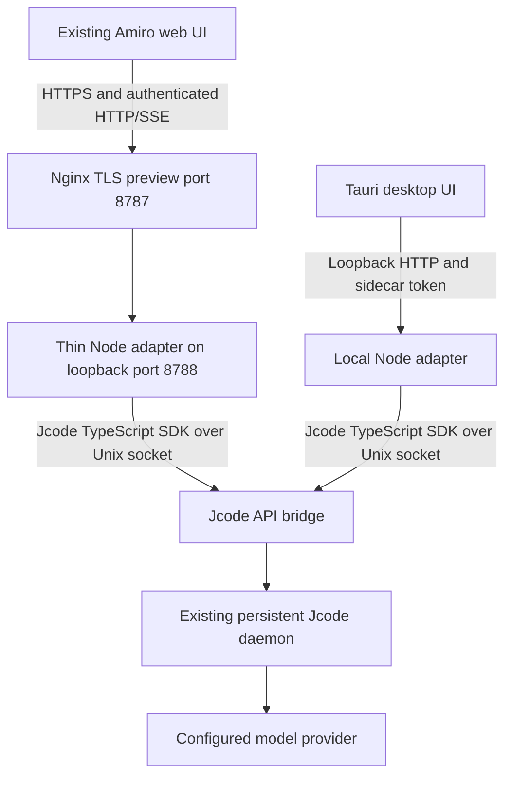

# Amiro

Amiro is a chat UI for the [Jcode](https://github.com/1jehuang/jcode) coding
agent. It pairs a [Tauri](https://tauri.app) (Rust) desktop shell with a
statically-exported [Next.js](https://nextjs.org) frontend and a thin **Node
adapter** that bridges the UI to a running Jcode daemon.

> **Current status:** this is a working local/preview build, not a finished,
> self-contained desktop product. The Go backend that used to live in this repo
> has been removed; the adapter is now the only backend and it is plain Node
> (≥ 22). **[`docs/AMIRO-RUNTIME.md`](docs/AMIRO-RUNTIME.md) is the source of
> truth** for architecture, quickstart, login, restrictions, and known gaps.
> Older documents in `docs/` (including `amiro-on-jcode.md`) are design history,
> not statements of what works today.

## What Amiro is (and is not)

- Amiro is the product name and UI. It does **not** fork, vendor, or reimplement
  Jcode: `bin/amiro` delegates to the installed `jcode` CLI, and the adapter
  talks to Jcode through the upstream `@1jehuang/jcode-sdk`. Jcode owns model
  execution, session history, and provider routing; the adapter is transport,
  application authentication, UI compatibility, and thread↔session mapping.
- The adapter does **not** implement its own agent loop, database, or provider
  integrations.

## Architecture



The desktop shell spawns the adapter as a sidecar, reserves an ephemeral
`127.0.0.1:0` port for it, generates a per-launch shared-secret token, and
injects the port/token into the webview (`window.__BACKEND_PORT__` /
`window.__BACKEND_TOKEN__`) before the first request.

## Prerequisites

| Tool | Version | Notes |
|---|---|---|
| [Node.js](https://nodejs.org) | ≥ 22 | the adapter is Node ≥ 22; the Next.js frontend needs ≥ 20.9 |
| [Jcode](https://github.com/1jehuang/jcode) | current | the adapter drives it; `jcode` must be on `PATH` |
| [pnpm](https://pnpm.io) | 10.x | repo pins `pnpm@10.2.1` |
| [Rust + Cargo](https://rustup.rs) | ≥ 1.77.2 | only for the Tauri desktop shell |
| [Tauri CLI](https://v2.tauri.app/reference/cli/) | 2.x | `cargo install tauri-cli --version "^2" --locked`; invoked as `cargo tauri ...` |

You do **not** need Go. The backend is JavaScript.

## Quickstart (from `docs/AMIRO-RUNTIME.md`)

```sh
pnpm install
npm --prefix adapter ci          # or: pnpm --dir adapter install
pnpm build                       # static export into out/
jcode --no-update api-bridge --api-socket /run/user/0/jcode-api.sock
JCODE_API_SOCKET=/run/user/0/jcode-api.sock pnpm start
```

`pnpm start` runs `node adapter/src/server.mjs`, which serves the static `out/`
export **and** the API from one listener. `AMIRO_HOME`, `AMIRO_HOST`,
`AMIRO_PORT`, and `JCODE_API_SOCKET` select the home, bind address, port, and
bridge socket; the adapter defaults to loopback.

### Application login

A random initial owner password is generated into
`$AMIRO_HOME/admin-initial-password` (a mode-0600 JSON file). There is no public
default password and registration is closed by default. Provider connections
(API keys / OAuth) are made from `/login` in the chat composer; they are not
submitted as chat messages. See `docs/AMIRO-RUNTIME.md` for the two-login model
and the preview's shared-credential scope.

## Tauri desktop (development)

```bash
cargo tauri dev
```

`tauri.conf.json`'s `beforeDevCommand` stages the adapter sidecar launcher
(`src-tauri/build-sidecar.sh`, output in `src-tauri/binaries/`) and starts
`pnpm dev -p 3210`, then opens the window against that dev server.

### Alternative: frontend-only dev (no Tauri shell)

Two terminals:

```bash
./scripts/dev-backend.sh        # Node adapter on http://127.0.0.1:8787
pnpm dev -p 3210                # Next.js dev server
```

Point the frontend at the adapter with `desktop/.env.local` (gitignored):

```bash
NEXT_PUBLIC_BACKEND_URL=http://127.0.0.1:8787
# NEXT_PUBLIC_BACKEND_TOKEN=   # empty in dev; the adapter accepts all when AMIRO_TOKEN is unset
```

These must match the env `scripts/dev-backend.sh` exports (`AMIRO_PORT`,
`AMIRO_TOKEN`). The packaged Tauri app ignores `.env.local`; the Rust shell
injects the port and token at launch.

## Packaging a desktop installer (not finished)

```bash
cargo tauri build
```

This packages platform installers, but **the desktop backend is not yet
distributable**: the sidecar slot holds a launcher that execs the local `node`
and the checkout's `adapter/src/server.mjs`. A shippable build needs the
adapter packaged (e.g. a Node SEA) or a bundled Node runtime, plus Jcode
installation/bridge lifecycle. See
[`src-tauri/SIDECAR-LIMITATIONS.md`](src-tauri/SIDECAR-LIMITATIONS.md). Do not
read a passing web preview as proof that a portable installer works.

## Restrictions in the current preview

Text chat works with tools disabled by default (`tools: { enabled: [] }`).
Model configuration is operator-controlled and a model-route failure does not
silently fall back to another provider. Browser-supplied tool/MCP lists cannot
widen permissions. Search, background execution, legacy skill generation,
checkpoint restore, MCP tool execution/authorization, and workflow execution
are **not enabled** and return explicit unsupported errors rather than
fabricated success. See `docs/AMIRO-RUNTIME.md` for the full list, the usage
page's scope caveats, and the "safe preview policy, not an OS sandbox" warning.

## Testing

Frontend (from the repo root):

```bash
pnpm test           # vitest unit tests
pnpm check-types    # tsc --noEmit
pnpm lint           # biome
pnpm check          # lint:fix + check-types + test
```

Backend adapter:

```bash
node --test adapter/test/usage.test.mjs     # unit
node adapter/test/live-smoke.mjs            # optional; needs a running, authenticated preview
```

The former Go test harness under `tests/` is **retired** (it targeted the
removed Go backend). Its fixtures and test code are kept for reference; see
[`tests/README.md`](tests/README.md).

## Project layout

```
.
├── src/                     # Next.js app, statically exported into the Tauri webview
├── adapter/                 # Node backend: HTTP router, SSE, jcode bridge, routes/, test/
├── bin/amiro                # thin CLI wrapper that delegates to `jcode`
├── src-tauri/               # Rust shell: sidecar lifecycle, window creation, bundler config
│   ├── src/lib.rs           # reserves the port, spawns/kills the adapter sidecar, injects port+token
│   ├── build-sidecar.sh     # stages the adapter launcher into src-tauri/binaries/
│   └── SIDECAR-LIMITATIONS.md
├── scripts/                 # dev-backend, build-ui, start-local helpers
├── messages/                # next-intl translation files
└── docs/                    # docs/AMIRO-RUNTIME.md is the current guide
```

## Troubleshooting

- **`backend sidecar launcher not found`** — `src-tauri/build-sidecar.sh` didn't
  run or failed; ensure `rustc` and `node` are on `PATH`, then re-run
  `cargo tauri dev`.
- **Adapter exits immediately / `Cannot find module '@1jehuang/jcode-sdk'`** —
  adapter deps aren't installed: `npm --prefix adapter ci`.
- **`jcode` not found** — install Jcode, or set `AMIRO_JCODE_BIN` to its path.
- **401 from the app (frontend-only dev)** — `NEXT_PUBLIC_BACKEND_TOKEN` in
  `.env.local` doesn't match the adapter's `AMIRO_TOKEN`.
- **Linux: GTK/webkit errors under `cargo tauri dev`** — install
  `libwebkit2gtk-4.1-dev` and friends.

## License

`package.json` declares this project MIT-licensed. **No `LICENSE` file is
committed yet** — add one with the appropriate copyright holder before treating
this repo as open source. Jcode and `@1jehuang/jcode-sdk` remain their upstream
authors' works under their own licenses.
