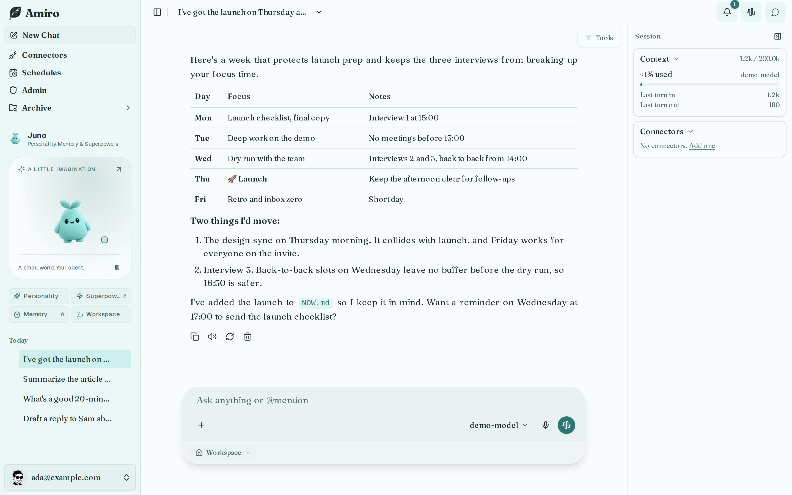
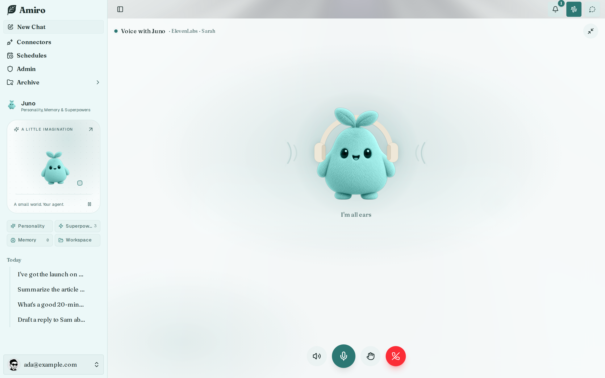
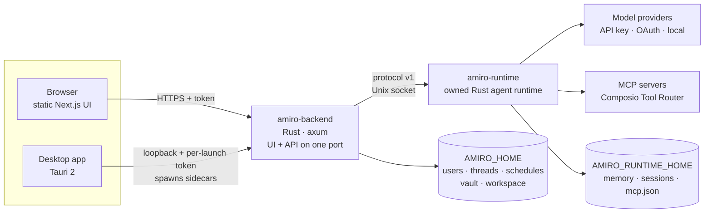

<div align="center">


# Amiro

**Your own AI agent, on your own machine.**

A personal agent with a face, a home folder, a schedule and a voice. It runs on
your laptop as a desktop app or on your own server, behind one install command.
The stack is Rust, plus a static web UI.

[](https://github.com/vallabha717/Amiro/actions/workflows/ci.yml)
[](https://github.com/vallabha717/Amiro/releases/latest)
[](LICENSE)
[](https://rustup.rs)
[](https://tauri.app)
[](https://nextjs.org)

[See it in action](#see-it-in-action) ·
[Quick setup](#quick-setup-5-minutes) ·
[Install](#install) ·
[Features](#features) ·
[Quick start](#quick-start) ·
[Configuration](#configuration) ·
[Architecture](#architecture) ·
[Security](#security) ·
[Docs](#documentation) ·
[Contributing](#contributing)

<br />

<picture>
  <source media="(prefers-color-scheme: dark)" srcset="docs/assets/readme/hero-chat-dark.png" />
  
</picture>

</div>

---

## See it in action

Every clip below was recorded on a fresh Amiro with a real model
(OpenCode Go: **`muse-spark-1.2-contributor`** and **`deepseek-v4.1-flash`**), the live web and real public services.
Nothing is scripted. (They were recorded on a cloud VM where keyless search
engines return nothing, so in the research clips Amiro reads the official pages
directly.) Click any GIF for the full-length MP4, or browse them all
on the docs' [See it in action](showcase.mdx) page.

<a href="docs/assets/showcase/research.mp4"></a>

<table>
  <tr>
    <td width="50%"><a href="docs/assets/showcase/schedules-morning-brief.mp4"></a><br/><b>A morning brief every weekday</b>, set up by asking.</td>
    <td width="50%"><a href="docs/assets/showcase/agent-desktop.mp4"></a><br/><b>Its own computer</b>: watch it browse and open files, live.</td>
  </tr>
  <tr>
    <td><a href="docs/assets/showcase/connectors-add.mp4"></a><br/><b>Any MCP server</b>: add DeepWiki, ask about a real repo.</td>
    <td><a href="docs/assets/showcase/team-new-agent.mp4"></a><br/><b>A team</b>: a travel-planner agent with its own setup.</td>
  </tr>
</table>

---

## Quick setup (5 minutes)

<a href="docs/assets/showcase/setup-first-run.mp4"></a>

1. **Install.** On a server or VM: `curl -fsSL https://github.com/vallabha717/Amiro/releases/latest/download/install.sh | bash`
   (add `-s -- --public --service` to reach it over the network and start at boot).
   On a laptop: download the [desktop app](#install).
2. **Open the address it prints → Get started.** Create the owner account
   (12+ character password; there is no sign-up and no cloud account).
3. **Follow the setup chat.** Pick a look and a personality, then on **Brain**
   search your provider (e.g. *OpenCode Go*), paste its key → **Save key** (it
   goes to the encrypted vault, never into the chat). On **Web search** pick
   **Bing** or **DuckDuckGo** (no key; on a cloud VM use a Brave or Tavily key).
   Skip the rest for now.
4. **Pick the model.** *Admin → Models & Providers* → **Set default** on the
   model you want → *Models & test* → **Run model test**.
5. **Ask something real**: *"Search the web and compare Obsidian, Logseq and
   Joplin for personal notes. Give me a table and cite your sources."*

Step-by-step with a video for every screen: [Quickstart](quickstart.mdx) ·
[First run](first-run.mdx).

---

## Install

**Server or VM (Linux, macOS; x86_64 and arm64; no root needed):**

```bash
curl -fsSL https://github.com/vallabha717/Amiro/releases/latest/download/install.sh | bash
```

To reach it over the network and keep it running across reboots, add `--public --service`:

```bash
curl -fsSL https://github.com/vallabha717/Amiro/releases/latest/download/install.sh | bash -s -- --public --service
```

**Desktop app.** Download the file for your OS from the
[latest release](https://github.com/vallabha717/Amiro/releases/latest):

| OS | Download |
| --- | --- |
| macOS (Apple silicon) | [`amiro-desktop-macos-aarch64.dmg`](https://github.com/vallabha717/Amiro/releases/latest/download/amiro-desktop-macos-aarch64.dmg) |
| macOS (Intel) | [`amiro-desktop-macos-x86_64.dmg`](https://github.com/vallabha717/Amiro/releases/latest/download/amiro-desktop-macos-x86_64.dmg) |
| Windows 10/11 | [`amiro-desktop-windows-x86_64-setup.exe`](https://github.com/vallabha717/Amiro/releases/latest/download/amiro-desktop-windows-x86_64-setup.exe) |
| Linux (any distro) | [`amiro-desktop-linux-x86_64.AppImage`](https://github.com/vallabha717/Amiro/releases/latest/download/amiro-desktop-linux-x86_64.AppImage) |
| Debian / Ubuntu | [`amiro-desktop-linux-x86_64.deb`](https://github.com/vallabha717/Amiro/releases/latest/download/amiro-desktop-linux-x86_64.deb) |

Not sure which file you need? See [Downloads: which file do I need?](#downloads-which-file-do-i-need)
Either way, the first launch opens a short setup wizard.

---

## Why Amiro

- **You own it.** One Rust binary serves the UI and the API, and your data
  lives in `~/.amiro`. There is no hosted service and no sign-up. A running
  Amiro needs no Node.js.
- **It's an agent, not a chat box.** Amiro has tools, connectors (MCP), skills,
  schedules that run on their own, a workspace of files it reads and writes,
  and — with the sandbox — a desktop of its own you can watch live. A
  heartbeat keeps it current between chats.
- **A team, not just one agent.** Add specialists (a researcher, a travel
  planner) with their own personality, models, connectors and container.
- **It has a personality you can see.** Pick a plush mascot and a colour, then
  tune the personality. The mascot lives in your sidebar and joins you in voice
  mode.
- **Bring any model.** Connect Anthropic, OpenAI, OpenRouter, Gemini,
  OpenCode Go and the rest of the catalog with a key, sign in with OAuth or device code, or point Amiro at a local
  OpenAI-compatible endpoint. Every route is pinned as `provider:model`, so it
  never switches models silently.
- **Configure it in a file.** Everything the setup chat asks for can also live in
  `amiro.toml` or `.env`, so a scripted install never needs a browser.

---

## Features

### Research, documents and charts — the everyday work

<a href="docs/assets/showcase/research.mp4"></a>

Ask the way you would ask a person. Amiro searches (Bing and DuckDuckGo need no key;
Brave, Tavily, Exa, Serper, Firecrawl and SearXNG are one click away), reads
the pages, and answers with tables, code, Mermaid diagrams and the sources it
used. Search and fetch calls fold into one "work" row you can open, and the
**Tools** filter hides them down to "answers only". In the composer, `/` lists
the runtime's commands (`/compact`, `/context`, `/memory`, `/mcp`…) and your
skills, and `@` finds files in the chat's folder. See
[Everyday tasks](using/everyday-tasks.mdx) and [docs/CHAT-UX-AND-SWARM.md](docs/CHAT-UX-AND-SWARM.md).

<table>
  <tr>
    <td width="50%"><a href="docs/assets/showcase/documents.mp4"></a><br/><b>Summarise and file it</b>: an article becomes <code>notes/pomodoro.md</code> in the workspace.</td>
    <td width="50%"><a href="docs/assets/showcase/visualize.mp4"></a><br/><b>Chart real numbers</b> with the Visualize superpower, inline in the reply.</td>
  </tr>
</table>

Attach PDFs, Word, Excel, PowerPoint, CSV, images, audio or video: every file
opens in the built-in viewer, and every path the agent mentions is a clickable
chip.

### Schedules: your agent works on its own

<a href="docs/assets/showcase/schedules-morning-brief.mp4"></a>

Each schedule runs a saved prompt once, on a cron expression or on an interval,
in its own timezone. Just ask — *"every weekday at 8, give me a morning brief:
the weather and the top 3 tech headlines"* — or use the page:

| Mode | What runs |
| --- | --- |
| **Reminder** (`notify`) | Posts the prompt as a message. No model call. |
| **Text only** (`execute`) | One model turn with tools off and the model pinned. |
| **Agent** (`agent`) | A full agent turn with tools, connectors and the agent home, like a chat. |
| **Script** (`script`) | A shell command in the workspace; its output is the run result. |

**Inbox cleanup playbook.** Click *Set up this schedule for me* and Amiro
renders the rules as switches (keep reservations and recent bills, clean up
promotions and notifications), then saves the schedule:

<a href="docs/assets/showcase/schedules-inbox-cleanup.mp4"></a>

Wall times that don't exist or happen twice across a DST change are rejected,
not shifted, and a cross-process lock stops two backends firing the same
schedule twice. Results land in the **Bell** inbox, optionally on Telegram,
Slack or Discord. See [Schedules](using/schedules.mdx) and [docs/SCHEDULES.md](docs/SCHEDULES.md).

### Connectors: MCP servers and 1,000+ apps

<table>
  <tr>
    <td width="50%"><a href="docs/assets/showcase/connectors-add.mp4"></a><br/><b>Add any MCP server</b> from the page: here DeepWiki, then a real question about <code>tokio-rs/tokio</code>.</td>
    <td width="50%"><a href="docs/assets/showcase/connectors-agent.mp4"></a><br/><b>Or just ask.</b> The agent adds Context7 itself and reads current axum docs.</td>
  </tr>
</table>

One page lists everything the agent can reach: remote MCP servers (Streamable
HTTP or SSE, no auth, bearer, API-key header or OAuth), local MCP commands, and
apps through Composio's Tool Router. When a server needs a key, the agent asks
in a **secure card**; the value goes to the encrypted vault and never passes
through the chat. See [Connectors](using/connectors.mdx), [docs/CONNECTORS.md](docs/CONNECTORS.md)
and [docs/COMPOSIO.md](docs/COMPOSIO.md).

### Its own computer: the TV

<a href="docs/assets/showcase/agent-desktop.mp4"></a>

With the sandbox running (`bash scripts/sandbox.sh up`, needs Docker), every
agent has a real Linux desktop in its container — Chromium, Files and a
terminal. The **Monitor** button in the chat header opens it as a live,
clickable TV. The agent drives it with `desktop_open` / `desktop_state`, each
call shows a TV card in the chat naming the exact folder or URL on screen, and
**Admin → Debug → Terminal** is the same shell as the TV's terminal. See
[Agent desktop](using/agent-desktop.mdx).

### A team of agents

<a href="docs/assets/showcase/team-new-agent.mp4"></a>

**Team → New agent** runs the same guided setup chat for a specialist: its own
name, role, instructions, look, personality, provider, search engine, remote
connectors, workspace, schedules and (with the sandbox) container. **Team →
Usage** shows tokens and cost per agent. See [Team](using/team.mdx).

### An agent with a home, a memory and a personality

<table>
  <tr>
    <td width="50%"><a href="docs/assets/showcase/memory.mp4"></a><br/><b>Memory</b>: tell it once; a brand-new chat already knows.</td>
    <td width="50%"><a href="docs/assets/showcase/agent-hub.mp4"></a><br/><b>Personality, Superpowers, home files.</b></td>
  </tr>
</table>

- **Agent home.** The workspace (`~/.amiro/workspace`) holds files that load
  into every turn: `IDENTITY.md` (who it is), `SOUL.md` (how it works, including
  rules it writes when you correct it), `USER.md` (you) and `NOW.md` (what's
  going on). A `journal/` folder holds dated entries. See [docs/AGENT-HOME.md](docs/AGENT-HOME.md).
- **Heartbeat.** Every few hours (with quiet hours), a background turn runs the
  `HEARTBEAT.md` checklist and posts a note if something needs you.
- **Personality and look.** Presets and dials with a live sample reply, four
  plush mascots in nine colours, and a sidebar theme that follows the colour.
- **Superpowers.** Built-in skills — Visualize, Schedules, MCP Setup, Frontend
  design, GEO article writer, CLI discovery — plus your own. Skills change
  instructions, not permissions. See [docs/skills/README.md](docs/skills/README.md).

### Voice mode with your mascot



You talk, Amiro detects the end of your sentence, answers through the normal
chat stream and reads it aloud as it is written; interrupt it any time
(barge-in). Live voice works with any keyed provider (OpenAI, Deepgram, Groq,
ElevenLabs); dictation and per-message read-aloud also work with the
browser's own engines. See [docs/LIVE-VOICE.md](docs/LIVE-VOICE.md) and
[docs/VOICE-AND-SPEECH.md](docs/VOICE-AND-SPEECH.md).

### Secrets stay out of the chat

<a href="docs/assets/showcase/secret-card.mp4"></a>

Secrets are encrypted at rest with AES-256-GCM under `~/.amiro/protected/`.
Agents ask for keys in a secure card, list views show only a masked hint, and
a key-shaped string pasted into the composer is caught and offered to the
vault instead. A brokered HTTP proxy can inject a secret server-side, scoped to
allowed domains, so the model never sees the raw value. See
[docs/CREDENTIAL-VAULT.md](docs/CREDENTIAL-VAULT.md) and [Security](#security).

### Phones and other devices

<a href="docs/assets/showcase/devices.mp4"></a>

Connect a phone or another desktop app the way you sign in to the GitHub CLI:
open your Amiro's address on the device (scan the QR in **Admin → Devices**), it
shows a short code, and you approve it on the computer. Each device gets its
own sign-in that you can remove any time. The desktop app can open a listener
on your Wi-Fi for approved phones only, and can connect to an Amiro on a server
instead of its own. See [Phones and devices](using/devices.mdx) and [docs/DEVICES.md](docs/DEVICES.md).

### Admin, at a glance

<a href="docs/assets/showcase/admin-tour.mp4"></a>

Models & Providers (every provider by key, OAuth, device code or local
endpoint; default model per provider card; model test), Search Providers with
a live connectivity test, Voice & Speech, Credentials, Notifications, Devices,
Usage & Users, and a Debug terminal (the same shell as the TV's terminal) — all
from **Admin**.

---

## What's new since v1.26.1

These are on `main` and ship in the next release:

- **The TV**: the agent's real desktop streamed into the chat, with agent
  desktop tools and exact workspace paths ([#31](https://github.com/vallabha717/Amiro/pull/31), [#33](https://github.com/vallabha717/Amiro/pull/33)).
- **Admin → Debug terminal**, shared with the TV's terminal ([#31](https://github.com/vallabha717/Amiro/pull/31)).
- **Inbox cleanup playbook**, session animal identities and the hover marquee for long titles ([#34](https://github.com/vallabha717/Amiro/pull/34)).
- **Device codes and phone access over Wi-Fi** ([#28](https://github.com/vallabha717/Amiro/pull/28)).
- **Generative UI cards** in chat: interactive questions, value intake and secret vault cards ([#25](https://github.com/vallabha717/Amiro/pull/25), [#26](https://github.com/vallabha717/Amiro/pull/26)).
- **Set default model** right on the provider card ([#26](https://github.com/vallabha717/Amiro/pull/26)).
- Web app and desktop shell moved into `clients/` ([#29](https://github.com/vallabha717/Amiro/pull/29)); `amiro-sandboxd` builds on Windows ([#30](https://github.com/vallabha717/Amiro/pull/30)).

The full list is in [CHANGELOG.md](CHANGELOG.md).

---

## Quick start

### Desktop app

Install the file for your OS from the [table above](#install) and open Amiro.
The app starts its own private server on a random local port, with a fresh
secret at every launch. It keeps data in `~/.amiro` (`%USERPROFILE%\.amiro` on
Windows).

### Server or VM

```bash
curl -fsSL https://github.com/vallabha717/Amiro/releases/latest/download/install.sh | bash
```

The installer downloads the archive for your OS and CPU and checks its SHA-256.
It installs to `~/.amiro/app/<version>`, links `amiro` into `~/.local/bin`, and
writes `~/.amiro/amiro.toml` with port 3000 and a random token. Then it starts
the server and prints the address to open.

Installer options go after `bash -s --`:

| Option | Effect |
| --- | --- |
| `--public` | Listen on all interfaces (for a VM you reach over the network) |
| `--service` | Start at boot (systemd user service, or launchd on macOS) |
| `--port N` | Web UI port (default 3000) |
| `--version vX.Y.Z` | Install a specific release |
| `--no-start` | Install only |

To reach a VM's Amiro from your laptop without exposing it, forward the port:
`ssh -L 3000:127.0.0.1:3000 your-vm`, then open http://localhost:3000.
If the server is reachable from the internet, put TLS (Caddy, nginx) in front
of it.

### The `amiro` command

| Command | What it does |
| --- | --- |
| `amiro start` / `stop` / `restart` / `status` | Run the server in the background (`start --foreground` to watch it) |
| `amiro url` | Print the address to open |
| `amiro logs [-f]` | Show the server log |
| `amiro service install [--system]` | Start at boot (`--system` installs a system unit with sudo) |
| `amiro config [edit]` | Show `amiro.toml` with secrets hidden, or open it in `$EDITOR` |
| `amiro reset-password` | Set a new owner password (signs out every session) |
| `amiro update [vX.Y.Z]` | Install the latest (or a given) release and restart |
| `amiro doctor` | Check the install, including OpenSSL 3 on Linux |
| `amiro uninstall [--purge]` | Remove the app (`--purge` also removes all data) |

Amiro has no email recovery, because it runs on your machine. If you forget the
password, run `amiro reset-password` on the machine running Amiro. For the
desktop app's paths, see [docs/SETUP.md](docs/SETUP.md#forgot-your-password).

### From source

```bash
git clone https://github.com/vallabha717/Amiro.git
cd Amiro
./scripts/setup-vm.sh        # system packages, Rust, Node, pnpm, deps, build (idempotent)

# or by hand:
pnpm install
pnpm build                   # static UI into clients/web/out/
scripts/build-native.sh      # amiro-backend + amiro-runtime (release)
AMIRO_PORT=8787 ./backend/target/release/amiro-backend
```

Then open http://127.0.0.1:8787. For the desktop shell in development, run
`cargo install tauri-cli --version "^2" --locked`, then `cargo tauri dev`.
[Developing Amiro](#developing-amiro) covers requirements, per-OS packages,
tests and troubleshooting.

---

## Downloads: which file do I need?

Every release on the [releases page](https://github.com/vallabha717/Amiro/releases/latest) contains these files:

| File | For | How to use |
| --- | --- | --- |
| `amiro-desktop-macos-aarch64.dmg` | Desktop app, Mac with Apple silicon (M1 and later) | Open it and drag Amiro to Applications. On first launch, right-click → Open (the app is ad-hoc signed, not notarized yet) |
| `amiro-desktop-macos-x86_64.dmg` | Desktop app, Intel Mac | Same as above |
| `amiro-desktop-windows-x86_64-setup.exe` | Desktop app, Windows 10/11 | Run the installer. The installer is unsigned, so SmartScreen warns: More info → Run anyway |
| `amiro-desktop-linux-x86_64.AppImage` | Desktop app, any Linux x86_64 | `chmod +x`, then run it |
| `amiro-desktop-linux-x86_64.deb` | Desktop app, Debian/Ubuntu | `sudo apt install ./amiro-desktop-linux-x86_64.deb` |
| `amiro-server-linux-x86_64.tar.gz`, `amiro-server-linux-aarch64.tar.gz`, `amiro-server-macos-aarch64.tar.gz`, `amiro-server-macos-x86_64.tar.gz` | Server for a VM or headless box | Don't download these by hand: `install.sh` picks the right one |
| `install.sh` | One-command server install | `curl -fsSL https://github.com/vallabha717/Amiro/releases/latest/download/install.sh \| bash` |
| `SHA256SUMS` | Checksums for every file | `sha256sum -c SHA256SUMS --ignore-missing` (`install.sh` verifies automatically) |

Releases carry GitHub build-provenance attestations. To verify a download, run:

```bash
gh attestation verify <file> -R vallabha717/Amiro
```

---

## Configuration

Everything is optional. Anything you leave out is set up in the wizard or later
in Settings. Settings are read in this order, and the first one found wins:

1. Environment variables
2. `.env` files: `$AMIRO_ENV_FILE`, then `./.env`, then `~/.amiro/.env`
3. `amiro.toml`: `--config <path>` or `$AMIRO_CONFIG`, then `./amiro.toml`, then `~/.amiro/amiro.toml`

```toml
[server]
host = "0.0.0.0"          # reach it from other machines (set a token!)
port = 3000
token = "long-random"     # injected into the pages Amiro serves

[owner]                   # creates the owner on first start; the wizard skips the password step
email = "you@example.com"
password_file = "~/.amiro/owner-password"
name = "Ada"
timezone = "Europe/London"

[agent]                   # applied once, while the agent has never been customised
name = "Juno"
avatar = "sprout"         # headphones | sprout | starfish | dreamer
color = "teal"            # green orange pink purple teal yellow indigo cobalt black
default_model = "anthropic-api:claude-sonnet-5-5"

[providers]               # imported once into the encrypted credential store
anthropic_api_key = "sk-ant-…"

[onboarding]
skip = false              # true = never show the wizard (fully scripted installs)
```

Run `amiro-backend init-config` to write a commented starter file. The full
reference is [`amiro.example.toml`](amiro.example.toml), and every key names
its environment variable. A typo such as `[owner] emial` is reported at
startup, not silently ignored.

<details>
<summary><b>All environment variables</b></summary>

| Variable | Default | Meaning |
|---|---|---|
| `AMIRO_HOME` | `~/.amiro` | Application home: users, threads, stores, workspace |
| `AMIRO_RUNTIME_HOME` | `$AMIRO_HOME/runtime` | Runtime home: memory, sessions, runtime credential layout, `mcp.json` |
| `AMIRO_HOST` | `127.0.0.1` | Bind address |
| `AMIRO_PORT` | `8787` (`3000` from `install.sh`) | Bind port |
| `AMIRO_TOKEN` | empty | Shared secret every browser request must carry. Empty accepts all, which is only safe on loopback |
| `AMIRO_ALLOWED_ORIGIN` | unset | Extra permitted browser origin for cross-origin requests |
| `AMIRO_OUT_DIR` | `./out` | Directory of the static UI to serve |
| `AMIRO_CONFIG` / `AMIRO_ENV_FILE` | unset | Explicit `amiro.toml` / `.env` path |
| `AMIRO_API_SOCKET` | `$AMIRO_RUNTIME_HOME/amiro-api.sock` | Unix socket between backend and runtime |
| `AMIRO_RUNTIME_BIN` | auto-detected | Path to `amiro-runtime`. An unusable explicit value fails loudly |
| `AMIRO_RUNTIME_DIR` | `$AMIRO_RUNTIME_HOME/run` | Runtime bridge run files |
| `AMIRO_NO_RUNTIME_SPAWN` | unset | `1` requires an already running bridge |
| `AMIRO_NO_RUNTIME_KEEPALIVE` | unset | `1` disables the supervisor that pings and restarts the runtime |
| `AMIRO_NO_SCHEDULER` | unset | `1` disables the schedule ticker for this process |
| `AMIRO_SKIP_ONBOARDING` | unset | `1` never shows the first-run wizard |
| `AMIRO_OWNER_EMAIL` / `AMIRO_OWNER_PASSWORD` / `AMIRO_OWNER_PASSWORD_FILE` | unset | Provision the owner at first boot, while no account exists (12+ character password) |
| `AMIRO_OWNER_NAME` / `AMIRO_OWNER_TIMEZONE` | unset | Owner profile used by schedules and the heartbeat |
| `AMIRO_AGENT_NAME` / `AMIRO_AGENT_AVATAR` / `AMIRO_AGENT_COLOR` | unset | Initial agent identity |
| `AMIRO_DEFAULT_MODEL` | unset | `provider:model` used when a request omits a model |
| `AMIRO_PINNED_MODELS` | unset | Hard allow-list of models. Anything else is rejected |
| `AMIRO_SESSION_TTL_DAYS` | `7` | Sign-in lifetime in days (`0` = until sign-out) |
| `AMIRO_DEVICE_SESSION_TTL_DAYS` | `0` | Paired-device sign-in lifetime in days (`0` = until removed in Settings → Devices) |
| `AMIRO_REMOTE_PORT` | `8790` | Port of the phone-access listener (Settings → Devices) |
| `AMIRO_BROWSE_ROOTS` | `/root,/home,/srv,/opt,/var/www,/tmp` | Roots the server-side folder picker may browse |
| `AMIRO_WORKSPACE_ROOT` | `$AMIRO_HOME/workspace` | Default workspace for file, edit, search and git tools |
| `AMIRO_TOOL_PROFILE` | on | Tools run with the owner's permissions. `none` = chat without tools |
| `AMIRO_ENABLE_SKILL_GENERATION` | `0` | `1` re-enables legacy skill generation |
| `AMIRO_NO_TELEMETRY` | unset | `1` disables runtime telemetry |
| `NEXT_PUBLIC_BACKEND_URL` / `NEXT_PUBLIC_BACKEND_TOKEN` | unset | Frontend-only dev: backend URL and its `AMIRO_TOKEN` |

Provider keys belong in `[providers]` (imported once into the encrypted
store), the wizard, or **Admin → Providers**. Keys that only exist in the
shell environment of whoever started the server are not imported.

</details>

---

## Architecture



| Part | Path | What it does |
|---|---|---|
| **Web UI** | `clients/web/src/` → `clients/web/out/` | Next.js, statically exported, so a running Amiro needs no Node |
| **Backend** | `backend/` (`amiro-backend`) | Rust (axum): auth, threads, schedules, heartbeat, connectors, vault, voice, onboarding. It serves the UI and the API from one listener, and starts and supervises the runtime |
| **Runtime** | `runtime/` (`amiro-runtime`) | Amiro-owned Rust agent runtime (a modified fork of [jcode](https://github.com/1jehuang/jcode), MIT). It runs the models, sessions, tools, MCP and memory |
| **Desktop shell** | `clients/desktop/` | Tauri 2. Reserves a loopback port, generates a per-launch secret, runs backend and runtime as sidecars |
| **CLI** | `packaging/amiro`, `install.sh` | The server installer and the `amiro` management command |

[docs/AMIRO-RUNTIME.md](docs/AMIRO-RUNTIME.md) is the source of truth for
runtime behaviour. Mind the two homes: `AMIRO_HOME` is the application's data,
and `AMIRO_RUNTIME_HOME` is the runtime's.

---

## Security

Amiro is a **single-owner** app, designed to run on your own machine or in a
VM you control. Before exposing it to anyone else, know these limits:

- **There is no sign-up and no default password.** One owner account is
  created by the wizard or the config file. Passwords need 12+ characters,
  sign-in is rate-limited, and changing the password signs out every other
  session.
- **Tools run with the owner's permissions by default.** The restrictions are
  Amiro's own policy, not an OS sandbox, so treat the VM or container as the
  boundary. To chat without tools, set `AMIRO_TOOL_PROFILE=none`. There are no
  per-action approval prompts yet.
- **Bind to loopback, or use a token and TLS.** On a non-loopback address,
  always set `[server] token` and put TLS in front. The backend rejects
  arbitrary cross-origin requests.
- **The vault protects against casual disclosure, not a local attacker.** The
  key sits beside the encrypted file, and secrets passed to the runtime as
  environment variables are visible to its child processes.
- **Provider credentials are shared operator credentials.** This is not a
  multi-tenant service.

Details: [docs/SECURITY-MODEL.md](docs/SECURITY-MODEL.md) ·
[docs/CREDENTIAL-VAULT.md](docs/CREDENTIAL-VAULT.md). Report vulnerabilities
privately through GitHub security advisories; see [SECURITY.md](SECURITY.md).

---

## Documentation

The user guide lives in this repo root as Mintlify pages (`docs.json`, `introduction.mdx`, `showcase.mdx`, `using/`, `settings/`, `reference/`), with a video for every setup step. Start with [See it in action](showcase.mdx), [Quickstart](quickstart.mdx) and [Everyday tasks](using/everyday-tasks.mdx). Connect the repo in Mintlify to publish it, or preview with `npx mintlify dev`.

| Document | Contents |
|---|---|
| [docs/SETUP.md](docs/SETUP.md) | First-run wizard, `amiro.toml` / `.env`, desktop app, installer, releases, password reset |
| [docs/VM-SETUP.md](docs/VM-SETUP.md) | Full from-source walkthrough, including WSL2 and headless servers |
| [docs/AMIRO-RUNTIME.md](docs/AMIRO-RUNTIME.md) | **Source of truth:** architecture, login, providers, models, tools, restrictions |
| [docs/AGENT.md](docs/AGENT.md) · [docs/AGENT-HOME.md](docs/AGENT-HOME.md) | Agent hub, mascots, personality; agent home files, heartbeat, workspace |
| [docs/CHAT-UX-AND-SWARM.md](docs/CHAT-UX-AND-SWARM.md) | Session panel, tool filter, inline images, streaming, swarm panes |
| [docs/SCHEDULES.md](docs/SCHEDULES.md) | Schedules guide, modes, DST rules, daemon behaviour |
| [docs/CONNECTORS.md](docs/CONNECTORS.md) · [docs/COMPOSIO.md](docs/COMPOSIO.md) | MCP connectors, agent-built connectors, vault-backed secrets; Composio Tool Router |
| [docs/LIVE-VOICE.md](docs/LIVE-VOICE.md) · [docs/VOICE-AND-SPEECH.md](docs/VOICE-AND-SPEECH.md) | Live voice protocol and voice room; dictation, read-aloud, STT/TTS providers |
| [docs/skills/README.md](docs/skills/README.md) | Skill discovery, activation, authoring and safety |
| [docs/DEVICES.md](docs/DEVICES.md) | Device codes, paired devices, phone access over Wi-Fi |
| [docs/multi-agent-team-isolation/](docs/multi-agent-team-isolation/) | Team agents, the sandbox supervisor and per-agent containers |
| [docs/SECURITY-MODEL.md](docs/SECURITY-MODEL.md) · [docs/CREDENTIAL-VAULT.md](docs/CREDENTIAL-VAULT.md) | Owner auth, vault, sandbox boundary |
| [docs/settings-ui.md](docs/settings-ui.md) · [docs/search-runtime.md](docs/search-runtime.md) · [docs/chat-titles.md](docs/chat-titles.md) | Settings surfaces, configured search routing, runtime titles |
| [docs/RUST-RUNTIME.md](docs/RUST-RUNTIME.md) · [docs/runtime-upstream-update.md](docs/runtime-upstream-update.md) | Vendored runtime: provenance, crates, guarded upstream updates |
| [docs/testing/README.md](docs/testing/README.md) | Test architecture, config, artifacts and CI |
| [clients/desktop/SIDECAR-LIMITATIONS.md](clients/desktop/SIDECAR-LIMITATIONS.md) | Desktop packaging status |
| [docs/README.md](docs/README.md) | Full docs index |

Everything else under `docs/` (including dated session notes and `progress/` /
`phases/` folders) is design history, not a description of what runs today.

---

## Developing Amiro

<details>
<summary><b>Requirements</b></summary>

| Tool | Minimum | Why |
|---|---|---|
| [Node.js](https://nodejs.org) | **20.9** | Build and test the frontend only |
| [pnpm](https://pnpm.io) | **10.2.1** | Pinned via `packageManager` |
| [Rust](https://rustup.rs) | **1.89** | Backend, runtime and Tauri shell (1.88 fails on the pinned lockfile) |
| [Tauri CLI](https://v2.tauri.app/reference/cli/) | **2.x** | Desktop shell only: `cargo install tauri-cli --version "^2" --locked` |
| Python 3 | any | Only for the stub provider used by acceptance checks |

**Ubuntu / Debian** system packages:

```bash
sudo apt-get install -y build-essential pkg-config libssl-dev curl wget git file python3 \
  libwebkit2gtk-4.1-dev libgtk-3-dev libsoup-3.0-dev libjavascriptcoregtk-4.1-dev \
  libayatana-appindicator3-dev librsvg2-dev libxdo-dev
```

The WebKitGTK/GTK packages are only needed for the desktop shell. A headless
server needs none of them.

**macOS:** run `xcode-select --install` and `brew install pkg-config openssl@3`.

**WSL2:** build inside the Linux filesystem (`~/Amiro`), not under `/mnt/c`.
The desktop shell needs WSLg or an X server.

The agent runtime needs OpenSSL 3 on Linux (Ubuntu 22.04+, Debian 12+, Fedora,
RHEL 9).

</details>

<details>
<summary><b>Running in development</b></summary>

```bash
# Backend serving the built UI and the API
AMIRO_PORT=8787 ./backend/target/release/amiro-backend

# Desktop shell: stages the sidecars, starts `pnpm dev -p 3210`, opens the window
cargo tauri dev

# Build the desktop installers for this OS
node scripts/build-sidecar.mjs --build && pnpm desktop:package

# Full native acceptance in a browser, against a local stub provider
pnpm build
cargo build --manifest-path backend/Cargo.toml --bin amiro-backend
cargo build --manifest-path runtime/Cargo.toml --bin amiro-runtime
scripts/start-native-ui-check.sh
```

`bin/amiro` in a source checkout is a thin shim that runs the owned runtime
engine (`AMIRO_RUNTIME_BIN`, a sibling `amiro-runtime`, or
`runtime/target/{release,debug}/amiro-runtime`). It is not the installed
`amiro` management command.

</details>

<details>
<summary><b>Tests and verification</b></summary>

```bash
pnpm test            # vitest
pnpm check-types     # tsc --noEmit
pnpm lint            # biome
cargo test --manifest-path backend/Cargo.toml -- --test-threads=1
pnpm runtime:check   # the runtime check CI runs

# Browser acceptance: stub provider, real runtime, real UI
pnpm build && scripts/start-native-ui-check.sh
node scripts/verify-schedules-ui.mjs
node scripts/verify-agent-color-sync.mjs
node scripts/verify-settings-workflows.mjs
```

The backend integration tests start real servers, so they are most reliable
when run serially (`--test-threads=1`).

</details>

<details>
<summary><b>README and docs videos</b></summary>

The GIFs, MP4s and posters in `docs/assets/showcase/` come from the showcase
recordings in [`tests/showcase/`](tests/showcase/). They reuse the E2E harness:
a throwaway Amiro under `/tmp/amx-e2e-*` (never your `~/.amiro`), the agent
sandbox when Docker and the images are present, and the **real** provider and
keys from your gitignored `tests/e2e.config.json` (the videos use OpenCode Go
with `muse-spark-1.2-contributor` and `deepseek-v4.1-flash`). Every
scene is a real task — live web research, a public MCP server, the agent's real
desktop — with captions for each step.

```bash
pnpm build && scripts/build-native.sh          # if clients/web/out/ or the binaries are missing
bash scripts/sandbox.sh up                      # optional: the agent desktop scene needs it
pnpm --dir tests showcase                       # record every scene (or --project research)
pnpm --dir tests showcase:export                # → docs/assets/showcase/<scene>.{mp4,gif,jpg}
```

`export-media.mjs` drops frozen frames (long model waits), writes a 1280-wide
H.264 MP4 for the docs, a sped-up GIF under 4.5 MB for this README, and a poster
frame. The older stills in `docs/assets/readme/` come from
[`scripts/capture-readme-media.mjs`](scripts/capture-readme-media.mjs).

</details>

<details>
<summary><b>What works today, and what doesn't</b></summary>

**Works:** streaming chat with history, archive, export and uploads. Team agents with their own spaces and containers. The agent desktop (TV). Device-code pairing and phone access. Provider
connection by OAuth, device code, API key or local endpoint. The model catalog.
Agent identity, personality, skills, agent home and heartbeat. Read-only
memory. The workspace browser. Schedules in all three modes. Configured-only
web search. The encrypted vault. MCP and Composio connectors. Configured
STT/TTS, and live voice with ElevenLabs. Notifications. The desktop app with
backend and runtime as sidecars. The curl installer and the `amiro` CLI.

**Not enabled, and returns an explicit error rather than pretending:**
per-action tool approval and permission prompts, checkpoint restore, legacy
skill generation, and remote URL ingestion for uploads.

**Known gaps:** the macOS app is ad-hoc signed and not notarized, and the
Windows installer is unsigned. There is no auto-update feed for the desktop app
yet; `amiro update` covers servers. Amiro is single-operator, not multi-tenant.
Each external provider still needs its own authorization and network access,
and failures surface as errors.

</details>

<details>
<summary><b>Project layout</b></summary>

```
.
├── clients/        One folder per client (see clients/README.md)
│   ├── web/        Next.js app: src/, messages/ (next-intl), public/; exported to web/out/
│   ├── desktop/    Tauri 2 desktop shell, sidecar staging and bundler config
│   └── mobile/     Tauri mobile app (iOS + Android), not started yet
├── backend/        Native Rust backend (axum) + integration tests
├── runtime/        Amiro-owned Rust agent runtime (vendored fork, MIT, provenance kept)
├── agent-home/     Templates for the agent home files (SOUL.md, NOW.md, ...)
├── agent-skills/   Built-in skills (visualize, mcp-setup, schedules)
├── packaging/      The `amiro` management CLI shipped with server releases
├── install.sh      The curl installer
├── bin/amiro       Source-checkout shim that runs the runtime engine
├── scripts/        Setup, build, packaging, acceptance and capture scripts
├── adapter/        Retired Node compatibility harness (contract tests only)
├── tests/          Retired Go harness, contract checks, fixtures
└── docs/           Living docs (start with AMIRO-RUNTIME.md and SETUP.md)
```

</details>

<details>
<summary><b>Troubleshooting</b></summary>

| Symptom | Cause and fix |
|---|---|
| `amiro-backend` or `Amiro runtime executable not found` | Run `scripts/build-native.sh`, or point `AMIRO_RUNTIME_BIN` at an `amiro-runtime` |
| Runtime fails to start on Linux | It needs OpenSSL 3. Run `amiro doctor` |
| `libwebkit2gtk` / GTK errors under `cargo tauri dev` | Install the WebKitGTK packages above, or skip the desktop shell on a headless box |
| `command not found: pnpm` | `corepack enable && corepack prepare pnpm@10.2.1 --activate` |
| Port already in use | `AMIRO_PORT=8790 …`, or `[server] port` in `amiro.toml` |
| 401 in frontend-only dev | `NEXT_PUBLIC_BACKEND_TOKEN` must match the backend's `AMIRO_TOKEN` |
| No models listed after sign-in | No provider is connected yet. Use the setup chat's provider step or **Admin → Providers** |
| Schedule edits rejected with 409 | Another backend holds the scheduler lock for this `AMIRO_HOME`. Use that instance |
| Forgot the password | `amiro reset-password` on the machine running Amiro |

</details>

---

## Contributing

Contributions are welcome. See [CONTRIBUTING.md](CONTRIBUTING.md) and the
[Code of Conduct](CODE_OF_CONDUCT.md). In short:

1. Branch from `main`.
2. Never report success you didn't observe. Unsupported paths must return an
   explicit error, not a plausible result.
3. Before opening a pull request, run `pnpm check-types`, `pnpm lint`,
   `pnpm test` and `cargo test --manifest-path backend/Cargo.toml`.
4. In the PR, describe what you ran and what you saw.

## License and acknowledgements

Amiro is [MIT licensed](LICENSE). Full attribution is in
[THIRD-PARTY-NOTICES.md](THIRD-PARTY-NOTICES.md):

- **[Jcode](https://github.com/1jehuang/jcode)** by Jeremy Huang (MIT).
  `runtime/` is a modified source fork, pinned to an upstream commit, with the
  original notice kept in [runtime/LICENSE](runtime/LICENSE). Upstream
  endorsement is not implied.
- **CopilotKit/OpenDots** by Atai Barkai (MIT). The plush mascot sprites in
  `clients/web/public/agent/opendots/` are used verbatim and tinted at runtime.
- **Vellum Assistant** served as an architectural reference. No code or brand
  assets are copied.
