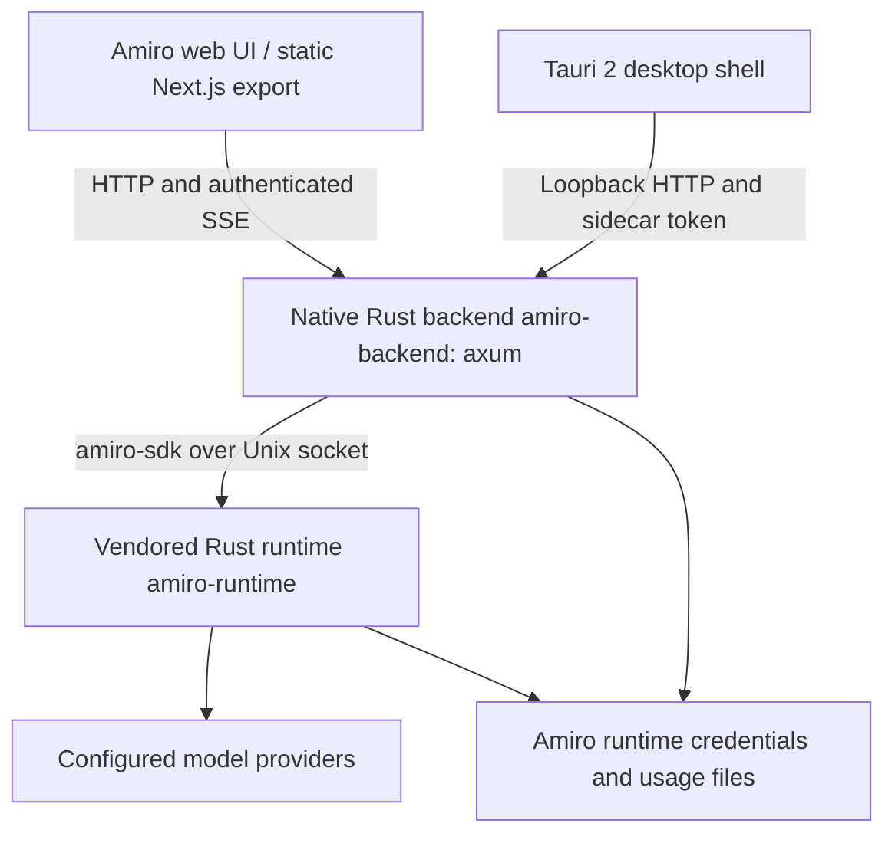

# Amiro runtime and preview

This is the current implementation guide. The pre-rename design note (`amiro-on-jcode.md`) is the earlier design proposal, not a deployment or completion report.

## Architecture



Amiro combines a Tauri 2 (Rust) desktop shell, a statically-exported Next.js frontend, a native Rust backend (`backend/`, binary `amiro-backend`, axum), and a vendored Rust runtime workspace (`runtime/`, binary `amiro-runtime`). There is no Go in the repository: the old Go backend was completely removed. The Node compatibility harness (`adapter/`) is retired and kept only for running contract tests.

The runtime engine lives in `runtime/`: an Amiro-owned, vendored Rust workspace producing `amiro-runtime`. The native backend (`backend/`) connects to the runtime over Unix sockets using the owned `amiro-sdk` client crate. The delegation shim `bin/amiro` executes the runtime engine, resolving `AMIRO_RUNTIME_BIN` or preferring the built binary at `runtime/target/{release,debug}/amiro-runtime`.

## Login

There are two different logins:

1. **Application sign-in:** a random initial owner password is generated into `$AMIRO_HOME/admin-initial-password`, a mode-0600 JSON file. There is no public default password. Registration is closed by default. An existing insecure `admin@local` account using the old `admin` default is rejected at startup, not reset.

   The owner may replace it with a shorter password through `PUT /api/user/password` (the UI profile flow uses the same route). This preview is owner-only, so that is the owner's choice. A short password on a publicly reachable admin account is a real risk. Compensating controls currently in place: sign-in is rate-limited to 15 attempts per 15 minutes per client address, registration is closed, and provider mutation is admin-only. Prefer a long password if the preview is left running unattended. A password change takes effect immediately and survives later logins.
2. **Provider connection:** use `/login` in the chat composer or the visible UI connection control in the admin panel. It opens a dedicated panel. API keys and authorization codes are never submitted as ordinary chat messages. OAuth starts a scriptable Amiro runtime CLI flow, displays the provider authorization URL or device code, accepts callback and code input separately, and polls for completion. The CLI receives callback secrets over stdin, not process arguments. After successful login, the runtime bridge is notified that authentication changed.

**Important scope:** this preview attaches to one owner's existing daemon and credential home. Provider credentials are shared runtime and operator credentials. Provider mutation is admin-only. This is not an isolated multi-tenant BYOK service. Enabling multiple untrusted users requires separate credential and daemon isolation and per-user provider selection before it is safe to call this production-ready.

The user's browser must complete real provider authorization. Tests can verify flow initiation, cancellation, and errors without authorizing or replacing the owner's existing credentials. A passing frontend build is not proof that every provider completed OAuth.

## Providers

The provider panel lists every provider the installed Amiro runtime supports, with its real mechanism, from `amiro provider list --json` joined with `amiro auth status --json` (`GET /api/providers/catalog`, cached 60s). Observed on this install: 55 providers, of which 5 are OAuth, 45 API key, 2 local endpoint, 1 device code, 1 CLI, plus the `auto` routing pseudo-provider. Each entry reports `connected`, `credentialSource`, `validation`, `lastRefresh`, `canStartOauth`, and `canAcceptApiKey`. Credential-looking values are redacted and key material is never returned or logged.

- **OAuth / device code** providers use the interactive flow (`/api/providers/:id/oauth/start|status|callback`), which surfaces the real provider URL or device code and never handles the user's password. OAuth eligibility is read from the live catalog field `canStartOauth`, not a hardcoded list, in both the retired adapter (`adapter/src/routes/provider-login.mjs`) and the native Rust backend (`backend/src/routes/provider_login.rs`). New engine OAuth providers work without code changes. A static list serves only as an emergency fallback when the live catalog cannot be parsed.
- **API key** providers are configured through `POST /api/providers/:id/api-key` (admin-only). The server writes the key with the runtime's own login path (`amiro login <provider> --no-validate` with the key on stdin, which stores it in the engine's real on-disk credential layout: `<configured runtime home>/config/jcode/<provider>.env` when a runtime home is configured, otherwise `$XDG_CONFIG_HOME/jcode`; `openai-compatible` additionally takes `--api-base`), then confirms the provider flips to available and notifies the bridge that auth changed. `DELETE /api/providers/:id/credentials` removes it from that same directory. A provider without an API-key mechanism is refused with an explicit error rather than silently doing nothing.
- The catalog cache is invalidated immediately via `invalidate_catalog()` whenever credentials change, so a newly connected provider's models are selectable immediately instead of waiting for the TTL.
- The admin add-provider menu lists every provider supported by the runtime, grouped by connection mechanism with live connected indicators.

## Models

The model selector offers the models of every **connected** provider. The native backend (`backend/src/models.rs`) builds this unified catalog for `/api/chat/models` and `/api/ai/providers`, plus `POST /api/ai/providers/models` for provider editor suggestions.

- **Live versus static fallback detection:** the runtime's `model list -p <id> --json` command degrades silently when offline or when dynamic refresh fails. It prints a warning to stderr (`failed to refresh dynamic model list`), still exits 0, and returns only a static fallback stub. The backend inspects stderr for `REFRESH_FAILED` (`live_is_complete` flag).
- **Attributed catalog merging:** cached on-disk catalogs (`<provider>_models.json` and `<provider>_models_cache.json`) are merged only when the live listing was incomplete or failed. Furthermore, cached catalogs are merged only when attributable to the provider (the recorded `source_api_base` matches the provider's configured endpoint, or the cached list shares a model name with the live list). Mismatched foreign cache files cannot pollute the provider's model list.
- **Namespacing:** models are namespaced `provider:model` for route pinning.

Environment semantics:

- `AMIRO_DEFAULT_MODEL` (set to `opencode-go:deepseek-v4.1-flash` on this preview) selects the model an omitted-model request uses and makes that provider group and model appear first.
- `AMIRO_PINNED_MODELS` acts as a hard allow-list when set: only those models are listed and anything else is rejected.
- With neither set, the connected-provider catalog is the allow-list. A model outside it is rejected with an explicit `model not allowed` error.
- A provider whose usage limit is exhausted still appears in the list; the turn fails with the provider's own upstream error message.

## Tools and permissions

The Amiro runtime controls tool execution through server-side configuration:

- **Tool availability:** `--tool-profile full|minimal/lite|none`, `--tools <allow-list>`, `--disabled-tools`, `--disable-base-tools`. This is configured per session on the backend.
- **Permission prompts:** the runtime bridge API does not advertise interactive prompt approval. The composer's old four-way picker (Auto / Edit Automatically / Manual / Plan), the tools selector dropdown, and the tool mode dropdown were removed.
- **Default preview policy:** the deployed preview defaults to `tools: { enabled: [] }`, reapplied before every turn. Enabling tools requires a trusted local operator to set both `AMIRO_TRUSTED_OPERATOR=1` and `AMIRO_TOOL_PROFILE=full`.

## Provider connection in the admin panel

Provider connection lives in the admin panel (`/admin/providers`). The chat window toolbar and greeting do not show ad-hoc connect buttons. The chat composer still accepts the `/login` command to open the connection panel.

## Folder selection from the web

The workspace folder picker browses the server's filesystem over HTTP without native OS dialogs. `src/components/chat/folder-browser-dialog.tsx` calls `GET /api/fs/roots|browse|stat`.

Safety rules in `backend/src/routes/fsbrowse.rs` (mirrored in `adapter/src/fsbrowse.mjs`):

- Allowed roots come from `AMIRO_BROWSE_ROOTS` (default `/root,/home,/srv,/opt,/var/www,/tmp`), absolute paths only.
- A deny list covers sensitive paths: `/root/.jcode`, `/root/.config/jcode`, `/root/.amiro-preview`, `/root/.ssh`, `/root/.aws`, `/root/.gnupg`, `/etc/letsencrypt`, `/etc/ssl/private`, `/root/.secrets`. Denied paths are neither listed nor enterable, before and after `realpath`.
- Every request is resolved with `canonicalize` / `realpath` and re-checked for root containment. Listing is capped at 500 entries and never returns file contents.
- `GET /api/fs/*` requires an authenticated session; anonymous requests return 401.

The chosen folder becomes the session's working directory. A directory change on an existing thread initiates a new session pinned to that directory while retaining thread identity and history. If the daemon starts in a mismatched directory, the turn fails closed with `working_dir_mismatch`.

## Agent surfaces and workspace browser

The Agent section (`/agent`) replaces the old standalone skills page:

- **Sidebar habitat:** the sidebar lists the Agent itself, not a list of skills. The habitat features an OpenDots mascot avatar, a playful cube, interactive hover greetings, and a pause control. Reduced-motion settings halt decorative animations.
- **OpenDots plush mascots:** avatars are official OpenDots plush characters (blue, mint, orange, purple, and midnight black plush) vendored from `CopilotKit/OpenDots` under MIT license (`THIRD-PARTY-NOTICES.md`). Old terms like "dot-lattice" and "Vellum catalogue" are stale.
- **Theme and accent synchronization:** the sidebar accent color persists directly to the user's agent identity (`traits.color`). Selecting an agent theme in the customizer updates the sidebar, and selecting a sidebar color theme persists the corresponding color trait to agent identity, keeping both surfaces in sync.
- **Popup UI primitive:** modal dialogs across the application use the shared `PopupShell` primitive (`src/components/ui/popup-shell.tsx`) featuring a fixed header, scrollable body, and fixed footer.
- **Admin workspace view:** `GET /api/agent/workspace` and `.../file` are admin-only, read-only, realpath-contained, and allowlisted by root (`runtime`, `amiro`, `project`). Secret and credential files are inaccessible; `config.toml` has sensitive values redacted.
- **Native memory inspection:** memory view is an admin-only, read-only inspection of the runtime's memory graphs. Mutations via HTTP return 501.

## Native schedules

Native schedules are delivered (`docs/SCHEDULES.md`, `/api/schedules`):

- Modes: `notify` (thread notification message) and `execute` (agent turn with tools disabled and model pinned server side).
- Cadences: `once`, `cron` (5-field expression), and `interval` (minutes).
- Timezone wall-time validation: per-schedule IANA timezones. Wall-time gaps caused by DST spring-forward and wall-time folds caused by DST fall-back ambiguity are rejected with HTTP 400. Explicit UTC offsets can resolve ambiguous instants.
- Cross-process advisory lock: an OS advisory file lock (`try_lock`) ensures only one backend process ticks and mutates schedules, with crash recovery on startup.
- Saved models: schedules honor their saved per-session models rather than inheriting daemon defaults.
- Manual agent runs and the `/api/background-jobs` endpoints were completely removed.

## Search providers

Search providers are supported in the native backend (`backend/src/routes/search_providers.rs`) and adapter (`adapter/src/routes/search-providers.mjs`):

- Supports all Vellum search options: `exa`, `tavily`, `brave`, `serper`.
- Supports custom search endpoints.
- `SearchProviderCard` (`src/components/search-provider-card.tsx`) renders the active `endpoint` and `baseUrl`.

## Restrictions

- Tool execution is disabled by default (`tools: { enabled: [] }`).
- Manual background agent runs were removed; native schedules are delivered under `/api/schedules`.
- The user-authored workflow feature and the chat's Workflow View (canvas, graph pane, header toggle, `@xyflow/react`) were completely removed.
- Uploaded files use opaque, expiring capabilities, bounded sizes, and download-only content types. Remote URL ingestion is disabled.
- Public application sign-in is rate-limited to 15 attempts per 15 minutes.

## Usage page

Quotas are read from `amiro usage --json`. Account-level OpenAI OAuth token counts and known costs are read from daily usage buckets.

- Self-view stats never 404: when the signed-in admin's id is absent from `users.json`, stats routes fall back to the session identity in both `backend/src/routes/admin.rs` and `adapter/src/routes/admin.mjs`. Unknown foreign ids still return 404.
- The usage client safely handles undefined periods without throwing.
- Usage is labeled as shared runtime provider-account scope, not per-user billing.

## Running and verifying locally

Build and run with native tools:

```sh
# Build native backend and runtime
pnpm native:build

# Run native backend in development
pnpm native:dev

# Run native backend unit and integration tests
pnpm native:test

# Check the vendored runtime workspace
pnpm runtime:check

# Run end-to-end browser acceptance checks
pnpm verify:native-ui
pnpm verify:schedules-ui
node scripts/verify-agent-color-sync.mjs

# Run retired adapter contract checks
node --test adapter/test/*.test.mjs
```

## Desktop packaging

Amiro's Tauri v2 desktop shell (`src-tauri/`) packages `amiro-backend` and `amiro-runtime` as native sidecars using `src-tauri/build-sidecar.sh` (or `build-sidecar.ps1` on Windows). The shell passes `AMIRO_RUNTIME_BIN` and coordinates sidecar lifecycle with parent process termination.
