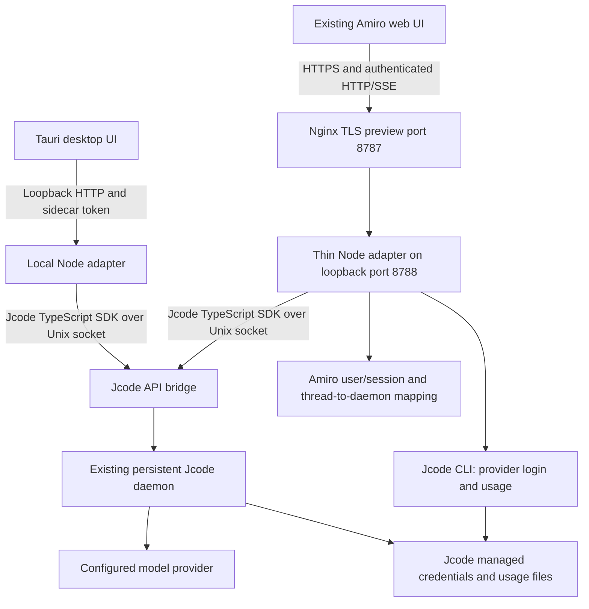

# Amiro runtime and preview

This is the current implementation guide. `amiro-on-jcode.md` is the earlier design proposal, not a deployment or completion report.

## Architecture



The adapter is transport, application authentication, and UI compatibility glue. It does not implement another agent reasoning loop. Jcode owns model execution, persisted session history, and model/provider routing. The old Go backend is removed from the active application.

Amiro is the product name. `bin/amiro` delegates to the upstream `jcode` CLI, not an uncredited fork. Jcode and `@1jehuang/jcode-sdk` retain their upstream identity and license attribution. The SDK used here is version 1.2.0, MIT licensed. The installed runtime used during verification is Jcode v0.95.0.

## Login

There are two different logins:

1. **Application sign-in:** a random initial owner password is generated into `$AMIRO_HOME/admin-initial-password`, a mode-0600 JSON file. There is no public default password. Registration is closed by default. An existing insecure `admin@local` account using the old `admin` default is rejected at startup, not reset.
2. **Provider connection:** use `/login` in the chat composer or the visible UI connection control. It opens a dedicated panel. API keys and authorization codes are never submitted as ordinary chat messages. OAuth starts a scriptable Jcode CLI flow, displays the provider authorization URL/device code, accepts callback/code input separately, and polls for completion. The CLI receives callback secrets over stdin, not process arguments. After successful login, the adapter notifies the daemon that authentication changed.

**Important scope:** this preview attaches to one owner's existing daemon and credential home. Provider credentials are shared runtime/operator credentials. Provider mutation is admin-only. This is NOT an isolated multi-tenant BYOK service. Enabling multiple untrusted users requires separate credential/daemon isolation and per-user provider selection before it is safe to call this production-ready.

The user's browser must complete real provider authorization. Tests can verify flow initiation/cancellation and errors without authorizing or replacing the owner's existing credentials. A passing frontend build is not proof that every provider completed OAuth.

## Restrictions

- The deployed preview defaults to `tools: { enabled: [] }`, reapplied to sessions before turns. Text chat works without giving the model server filesystem or shell access.
- Model configuration is operator-controlled. The preview exposes the requested OpenCode Go DeepSeek V4.1 Flash and Antigravity Gemini 3.8 Flash routes. A model-route failure does not silently select a different provider.
- Browser-supplied tool/MCP lists cannot widen permissions.
- Search is not implemented or enabled.
- Background execution, legacy skill generation, checkpoint restore, MCP tool execution/authorization, and workflow execution are not enabled. They return explicit unsupported errors rather than fabricated success.
- Uploaded files use opaque, expiring capabilities, bounded sizes, validated storage paths, and download-only content types. Remote URL ingestion is disabled.
- Public application sign-in is rate-limited. Arbitrary cross-origin browser requests are rejected.

These restrictions are a safe preview policy, not an OS sandbox. Do not enable unrestricted tools for public users. Workspace-aware custom tool handlers and an actual sandbox are separate work.

## Usage page

Quotas are read from `jcode usage --json`. Account-level OpenAI OAuth token counts and known costs are read from Jcode's daily usage buckets. Model activity counts are available from its SQLite activity database, but that table does not provide per-model token/cost attribution.

The UI explicitly labels shared-provider-account scope and OpenAI-only token/cost coverage. It does not distribute account tokens across unrelated models or claim per-user billing. Missing provider billing is not equivalent to zero actual provider usage. Thread counts only cover the Amiro user's own mapped threads, not unrelated shared daemon sessions.

## Running locally

```sh
pnpm install
npm --prefix adapter ci
pnpm build
jcode --no-update api-bridge --api-socket /run/user/0/jcode-api.sock
JCODE_API_SOCKET=/run/user/0/jcode-api.sock pnpm start
```

The adapter defaults to loopback. Select the home, host, port, and bridge socket with `AMIRO_HOME`, `AMIRO_HOST`, `AMIRO_PORT`, and `JCODE_API_SOCKET`. For an explicit restricted catalog, configure `AMIRO_PINNED_MODELS` with comma-separated provider-prefixed model routes. Bridge CLI startup flags alone do not select the model for newly created SDK sessions. The adapter must explicitly configure each session.

## This machine's preview

- Public entry: `https://194.238.18.234:8787`.
- TLS uses a temporary self-signed IP certificate. The browser will show a certificate warning. This is for testing, not production TLS.
- Node API: `127.0.0.1:8788`, not publicly bound.
- App data: `/root/.amiro-preview`, separate from any earlier development home.
- Initial sign-in email: `admin@local`. Read the generated password from `/root/.amiro-preview/admin-initial-password` on the server. Do not publish that file.
- Services: `amiro.service` and `amiro-bridge.service`.
- Dedicated API socket: `/run/user/0/amiro-preview-api.sock`, attached to the existing `/run/user/0/jcode.sock` daemon. The shared daemon is not replaced or restarted.
- Nginx configuration: `/etc/nginx/sites-available/amiro-preview`. Existing ports 80/443 and the Vellum site are unchanged.

```sh
systemctl status amiro amiro-bridge --no-pager
journalctl -u amiro -u amiro-bridge --since '10 minutes ago'
node --test adapter/test/usage.test.mjs
node adapter/test/live-smoke.mjs
```

`live-smoke.mjs` uses the real preview's credentials locally without printing them, invokes a small permitted-provider turn, verifies SSE and persisted history, and archives its test thread.

## Desktop limitation

The Tauri launch path is retargeted to the Node adapter. A launcher script is not a self-contained redistributed desktop backend. End-user installers still need a packaged Node runtime, adapter dependencies, Jcode installation/bridge lifecycle, and platform-specific launchers. A web preview being available does not prove a portable desktop installer works.

## Verification

Current observed checks and remaining limitations are recorded in `verification-amiro.md`. That report links the requirement-to-observation matrix (`requirement-traceability.md`) and the per-route auth/read observations (`route-observations.md`). Treat those reports, not older reconnaissance notes, as the completion evidence.
