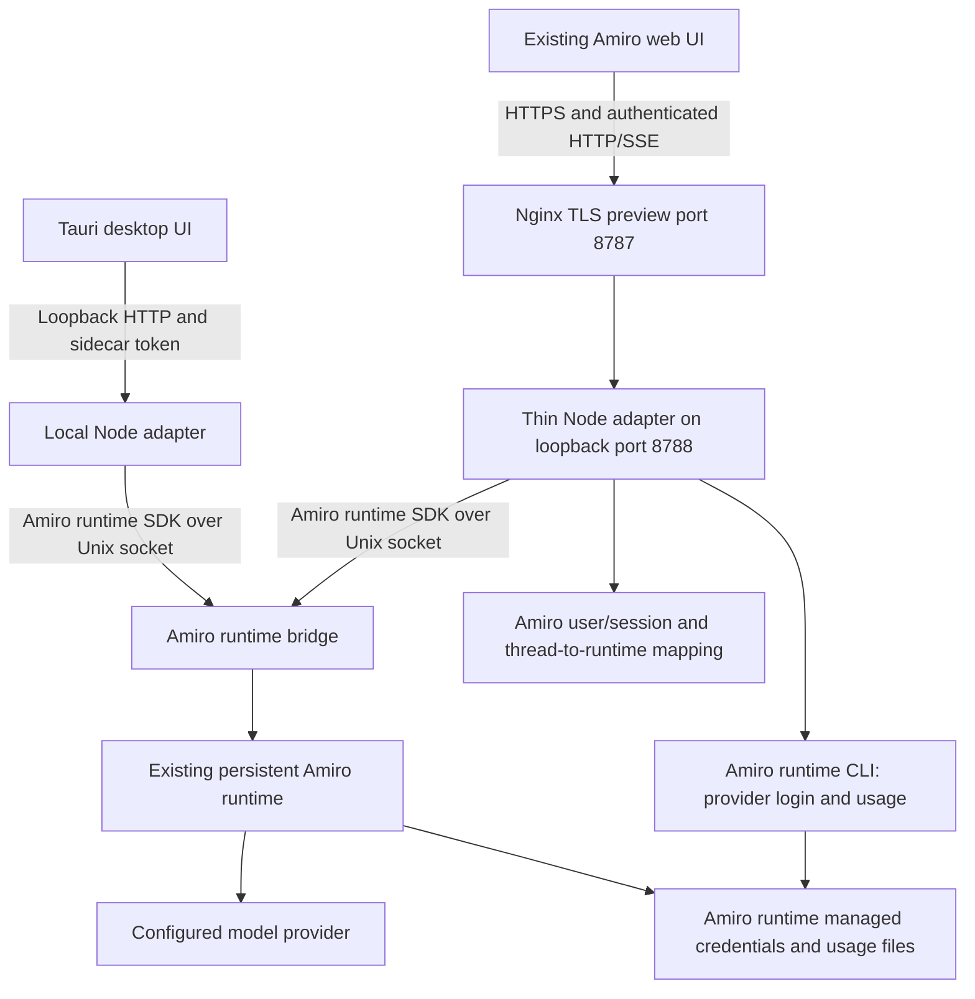

# Amiro runtime and preview

This is the current implementation guide. The pre-rename design note (`amiro-on-jcode.md`) is the earlier design proposal, not a deployment or completion report.

## Architecture



The adapter is transport, application authentication, and UI compatibility glue. It does not implement another agent reasoning loop. The Amiro runtime owns model execution, persisted session history, and model/provider routing. The old Go backend is removed from the active application.

Amiro is the product name. The runtime engine is a **separate program** that Amiro neither forks nor patches: `bin/amiro` is a delegation shim that execs an engine binary with the caller's arguments unchanged, and it says which engine and which source it resolved (`--help`, `--version`). Until the Amiro-owned build is in place, that engine is a compatibility install on `PATH`; the owned build produced by `scripts/build-native.sh` lives at `runtime/target/{release,debug}/amiro-runtime`, which the shim prefers as soon as it exists. The engine is powered by the MIT-licensed `@1jehuang/jcode-sdk` (version 1.2.0 here) and keeps its own identity and license attribution in full -- see `THIRD-PARTY-NOTICES.md`. The engine installed during verification reports v0.98.1, relayed verbatim by `amiro --version`.

## Login

There are two different logins:

1. **Application sign-in:** a random initial owner password is generated into `$AMIRO_HOME/admin-initial-password`, a mode-0600 JSON file. There is no public default password. Registration is closed by default. An existing insecure `admin@local` account using the old `admin` default is rejected at startup, not reset.

   The owner may replace it with a shorter password through `PUT /api/user/password` (the UI profile flow uses the same route). This preview is owner-only, so that is the owner's choice; a short password on a publicly reachable admin account is a real risk. Compensating controls currently in place: sign-in is rate-limited to 15 attempts per 15 minutes per client address, registration is closed, and provider mutation is admin-only. Prefer a long password if the preview is left running unattended. A password change takes effect immediately and survives later logins.
2. **Provider connection:** use `/login` in the chat composer or the visible UI connection control. It opens a dedicated panel. API keys and authorization codes are never submitted as ordinary chat messages. OAuth starts a scriptable Amiro runtime CLI flow, displays the provider authorization URL/device code, accepts callback/code input separately, and polls for completion. The CLI receives callback secrets over stdin, not process arguments. After successful login, the adapter notifies the runtime bridge that authentication changed.

**Important scope:** this preview attaches to one owner's existing daemon and credential home. Provider credentials are shared runtime/operator credentials. Provider mutation is admin-only. This is NOT an isolated multi-tenant BYOK service. Enabling multiple untrusted users requires separate credential/daemon isolation and per-user provider selection before it is safe to call this production-ready.

The user's browser must complete real provider authorization. Tests can verify flow initiation/cancellation and errors without authorizing or replacing the owner's existing credentials. A passing frontend build is not proof that every provider completed OAuth.

## Providers

The provider panel lists every provider the installed Amiro runtime supports, with its real mechanism, from `amiro provider list --json` joined with `amiro auth status --json` (`GET /api/providers/catalog`, cached 60s). Observed on this install: 55 providers, of which 5 are OAuth, 45 API key, 2 local endpoint, 1 device code, 1 CLI, plus the `auto` routing pseudo-provider. Each entry reports `connected`, `credentialSource`, `validation`, `lastRefresh`, `canStartOauth` and `canAcceptApiKey`; credential-looking values are redacted and key material is never returned or logged.

- **OAuth / device code** providers use the interactive flow (`/api/providers/:id/oauth/start|status|callback`), which surfaces the real provider URL or device code and never handles the user's password.
- **API key** providers are configured through `POST /api/providers/:id/api-key` (admin-only). The adapter writes the key with the runtime's own login path (`amiro login <provider> --no-validate` with the key on stdin, which stores it in the engine's real on-disk credential layout: `<configured runtime home>/config/jcode/<provider>.env` when a runtime home is configured, otherwise `$XDG_CONFIG_HOME/jcode` (`~/.config/jcode` here); `openai-compatible` additionally takes `--api-base`), then confirms the provider flips to available and tells the runtime bridge auth changed. `DELETE /api/providers/:id/credentials` removes it from that same directory. A provider without an API-key mechanism is refused with an explicit error rather than silently doing nothing.
- The catalog is rebuilt as soon as any credential change is reported, so a newly connected provider's models are selectable immediately instead of after the refresh interval.

## Models

The model selector offers the models of every **connected** provider, taken from `amiro model list -p <provider> --json` per connected provider. Observed on this install: 140 models across openai (11), opencode-go (39), openai-compatible (71) and antigravity (19). Models are namespaced `provider:model`, which is the route-pinned form the bridge needs; a bare model name would fall back to the daemon's default endpoint.

Environment semantics:

- `AMIRO_DEFAULT_MODEL` (set to `opencode-go:deepseek-v4.1-flash` on this preview) selects the model an omitted-model request uses and makes that provider group and model appear first, so a fresh chat starts on a known-working route rather than whichever provider happens to sort first.
- `AMIRO_PINNED_MODELS` remains a hard allow-list when set: only those models are listed and anything else is rejected. It is unset on this preview so that all connected providers are usable.
- With neither set, the connected-provider catalog is the allow-list. A model outside it is rejected with an explicit `model not allowed` error; there is no silent provider fallback. If the catalog cannot be built, the request is not refused (the daemon still rejects unknown ids) and the failure is logged.
- A provider whose usage limit is exhausted still appears; the turn fails with the provider's own error. OpenAI on this account reached its 5-hour limit during testing, which is an account state, not an adapter behaviour.

## Tools and permissions

The Amiro runtime has no permission *modes*. Its real controls are:

- **Tool availability:** `--tool-profile full|minimal/lite|none`, `--tools <allow-list>`, `--disabled-tools`, `--disable-base-tools`. This is what the adapter configures per session, and it is the only thing that decides whether the model may run anything at all.
- **Permission prompts (protocol):** a `permission_request` event answered with `allow`, `allow_always` or `deny` (`respondToPermission()` in the SDK, plus a `RunOptions.autoApprove` shortcut). The runtime SDK's own typings state that the **api-bridge does not advertise the `permissions` capability**, so it never issues prompts and a client that waits for one waits forever. Per-action approval is therefore unavailable through this bridge.
- **Ambient request review:** `amiro permissions` and `docs/SAFETY_SYSTEM.md` describe a two-tier system (auto-allowed / requires-permission) with a review queue. It is marked as design work and its only consumer is ambient mode, not chat.
- `amiro replay --auto-edit` compresses wait times when replaying a session recording. It is a video/timeline flag, unrelated to permissions.

Because none of that backs a user-facing mode, the composer's four-way picker (Auto / Edit Automatically / Manual / Plan), the tools selector (`tool-select-dropdown.tsx`) and the unused `tool-mode-dropdown.tsx` were **removed**. They were Amiro's own inventions, the adapter deliberately ignores client-supplied tool lists, and with this preview's tool policy there was nothing to run, write or approve. Nothing about tools or permissions is selectable in the UI now. The store's `permissionMode` default is `auto` (the only behaviour the bridge implements when tools are on: tools run without asking) and the adapter defaults an omitted `permissionMode` to `auto` as well. Enabling tools at all still requires a trusted local operator to set **both** `AMIRO_TRUSTED_OPERATOR=1` and `AMIRO_TOOL_PROFILE=full`; deployment sets neither.

## Provider connection lives in the admin panel

Provider connection is presented in the admin panel (`/admin/providers`). The chat window no longer shows a "Connect provider" button in the toolbar or in the empty-state greeting; both were removed on request. The chat can still open the same panel with the `/login` composer command, which the owner asked to keep earlier and which is intercepted before any model request.

## Folder selection (works from the web)

The workspace folder picker browses the **server's** filesystem over HTTP, so it works in a browser without a native OS dialog. `src/components/chat/folder-browser-dialog.tsx` calls `GET /api/fs/roots|browse|stat`; the old `showDirectoryPicker()`/`webkitdirectory` path (which only yields a bare folder name and cannot resolve to a server path) was removed.

Safety rules in `adapter/src/fsbrowse.mjs`:

- Allowed roots come from `AMIRO_BROWSE_ROOTS` (default `/root,/home,/srv,/opt,/var/www,/tmp`); absolute paths only.
- A deny list (exact and prefix) covers the runtime engine's real state directories (`/root/.jcode`, `/root/.config/jcode`) plus `/root/.amiro-preview`, `/root/.ssh`, `/root/.aws`, `/root/.gnupg`, `/etc/letsencrypt`, `/etc/ssl/private`, `/root/.secrets`. Denied paths are neither listed nor enterable, before and after `realpath`.
- Every request is realpath-resolved and re-checked for containment, so a symlink cannot escape an allowed root. Listing is capped at 500 entries and **never returns file contents**.
- `GET /api/fs/*` requires an authenticated session; anonymous requests are 401.

The chosen folder becomes the session's working directory: the chat request carries `workingDir` (also accepted as `projectDirectory`/`workspaceRoot`), it is validated with the same rules, and a rejected folder returns 403 instead of silently falling back. The directory is stored per thread and reported by `GET /api/thread/:id`. If the folder changes on a thread that already has a session, the adapter starts a new runtime session for that thread pinned to the new directory (same thread id and ownership; the previous session id is retained as `previousSessionId` and archived), so the selection actually takes effect.

The daemon echoes the directory it actually used when a session is created, and the adapter checks it: a session that starts somewhere other than the selected folder fails the turn with `working_dir_mismatch` rather than running in the wrong place. `adapter/tests/cwd-daemon.mjs` proves this end to end by reading the directory the daemon recorded for the session (`listSessions`), not the adapter's own mapping.

## Agent workspace browser (admin panel)

The Agent panel's workspace view (`GET /api/agent/workspace`, `.../file`) is admin-only, read-only, realpath-contained and allowlisted per root, the same way the folder picker is (`adapter/src/routes/agent.mjs`):

- Roots: `runtime` (the engine's state directory), `amiro` (the per-user persona mirror and workspace), `project` (the repo).
- The `runtime` root allows the `memory` and `skills` **directories** (so they can be listed and entered), their contents, `config.toml` and `prompt-overlay.md`. Everything else in that directory stays unlistable and unreadable, including credential files, `.pem`/`.sock` files and session directories.
- A directory node has to be allowed *itself* as well as its children; allowing only `memory/<file>` made the tree render empty. `adapter/test/workspace-listing.test.mjs` locks this down, together with symlink secrecy (a symlink inside an allowed directory that points outside is neither listed nor readable).
- `config.toml` can carry credentials inline, so what leaves the adapter is redacted: the values of credential-looking keys become `"<redacted>"`, the response reports `redacted: true` and `redactionCount`, and `*_env` / `*_name` references and counters stay readable. Key names are never hidden, so the config is still useful to inspect.
- Persona mirrors stay display-only: every write path returns 501.

## Restrictions

- The deployed preview defaults to `tools: { enabled: [] }`, reapplied to sessions before turns. Text chat works without giving the model server filesystem or shell access.
- Model configuration is operator-controlled: the selector offers the models of the connected providers, with `AMIRO_DEFAULT_MODEL` choosing the landing model and `AMIRO_PINNED_MODELS` (when set) acting as a hard allow-list. A model-route failure does not silently select a different provider.
- Browser-supplied tool/MCP lists cannot widen permissions.
- Search is not implemented or enabled.
- Background execution, legacy skill generation, checkpoint restore, and MCP tool execution/authorization are not enabled. They return explicit unsupported errors rather than fabricated success.
- The user-authored workflow feature was removed, not disabled -- first the builder (sidebar entry, `/workflow` and `/workflow/edit` pages, the flow canvas and its node editor, the `Workflow` app toolkit and `createWorkflow`/`updateWorkflow`/`getWorkflowStructure` tool names, the workflow mention type, and the whole `/api/workflow*` route family including its honest 501 `execute`; `GET /api/workflow` now 404s like any other unregistered path), then the chat's Workflow View -- a live graph derived from chat messages that lived in a wide pane toggled by the header's "Toggle Workflow View" button (on by default): the pane itself (`src/components/chat-graph/` canvas/panel/node/actions), the header toggle (`Chat.WorkflowView.toggle`) and its sidebar auto-collapse, the graph pane's client-side derivation/layout (`src/lib/ai/chat-graph/` with `derive-chat-graph.ts`/`layout-chat-graph.ts` and `src/types/chat-graph.ts` including `WORKFLOW_VIEW_LAUNCH_DATE`), the artifact pane's `canReturnToGraph` / "Back to graph" (`NetworkIcon`) branch, `statusFromNodeHistory` and `TerminalWindowCompact`, and the `@xyflow/react` dependency. The chat no longer shows a graph and there is no Workflow View toggle.
- Uploaded files use opaque, expiring capabilities, bounded sizes, validated storage paths, and download-only content types. Remote URL ingestion is disabled.
- Public application sign-in is rate-limited. Arbitrary cross-origin browser requests are rejected.

These restrictions are a safe preview policy, not an OS sandbox. Do not enable unrestricted tools for public users. Workspace-aware custom tool handlers and an actual sandbox are separate work.

## Usage page

Quotas are read from `amiro usage --json`. Account-level OpenAI OAuth token counts and known costs are read from the runtime's daily usage buckets. Model activity counts are available from its SQLite activity database, but that table does not provide per-model token/cost attribution.

The UI explicitly labels shared-provider-account scope and OpenAI-only token/cost coverage. It does not distribute account tokens across unrelated models or claim per-user billing. Missing provider billing is not equivalent to zero actual provider usage. Thread counts only cover the Amiro user's own mapped threads, not unrelated shared daemon sessions.

## Running locally

```sh
pnpm install
npm --prefix adapter ci
pnpm build
amiro --no-update api-bridge --api-socket /run/user/0/amiro-api.sock
AMIRO_API_SOCKET=/run/user/0/amiro-api.sock pnpm start
```

The adapter defaults to loopback. Select the home, host, port, and runtime socket with `AMIRO_HOME`, `AMIRO_HOST`, `AMIRO_PORT`, and `AMIRO_API_SOCKET` (the pre-rename `JCODE_API_SOCKET` is still read as a fallback). The engine's own home is separate from the adapter's `AMIRO_HOME`: it comes from `AMIRO_RUNTIME_HOME`, then the pre-rename `AMIRO_JCODE_HOME`/`JCODE_HOME`, and when none of those is set the engine resolves its own layout (state in `~/.jcode`, credentials in `~/.config/jcode`), which the adapter only ever reads -- nothing is migrated or rewritten, so an existing installation keeps working unchanged. `~/.amiro/runtime` is the intended default for the Amiro-owned runtime once it is the operational engine; the Node adapter deliberately does not switch to it yet, because the compatibility engine is still the one serving this preview. Model selection is described above (`AMIRO_DEFAULT_MODEL`, `AMIRO_PINNED_MODELS`), and the folder picker's roots come from `AMIRO_BROWSE_ROOTS`. Bridge CLI startup flags alone do not select the model for newly created SDK sessions, so the adapter explicitly configures each session.

`amiro --no-update api-bridge --api-socket ...` needs an engine binary: `scripts/build-native.sh` if the Amiro-owned runtime is what you want, otherwise the compatibility engine on `PATH`, or `AMIRO_RUNTIME_BIN`.

### Application home vs engine home

These are two different things and they must not be conflated:

- `AMIRO_HOME` is the **adapter's application data home** (`store/`, `users.json`, `threads.json`, `workspace/`, `admin-initial-password`).
- The engine has its own home. Unconfigured, this engine keeps *state* (memory, sessions, usage SQLite, OAuth tokens) in `~/.jcode` and *provider credentials* in `$XDG_CONFIG_HOME/jcode` (`~/.config/jcode` here).

The engine also reads `AMIRO_HOME` as a home, so the adapter **strips its own `AMIRO_HOME` from every child CLI process** (`buildRuntimeCliEnv` in `adapter/src/runtime.mjs`, regression-tested by `adapter/test/runtime-env.test.mjs`). Before that fix, the adapter exported `/root/.amiro-preview` (its app home, which holds no credentials) to `amiro auth status`/`amiro model list`, the engine looked for credentials in `<app home>/config/jcode`, and connected API-key providers (opencode-go, openrouter, ...) silently disappeared from the model catalog while the CLI run by hand showed them. To point the engine at a specific home, set `AMIRO_RUNTIME_HOME` (or the pre-rename `AMIRO_JCODE_HOME`/`JCODE_HOME`); the adapter then exports it to the engine and reads/writes credentials under `<home>/config/jcode`.

## Admin providers page

`/admin/providers` uses the same catalog. The add-provider menu (searchable, grouped by mechanism with per-provider connected state) lists every provider the Amiro runtime supports; it previously hardcoded six, which is why most providers could not be added. Selecting a provider opens the same `LoginPanel` preselected, so each kind gets its own correct flow: OAuth/device code, API key, or the honest "this backend does not expose that flow" message for CLI/local-endpoint. `openai-compatible`/custom gateways still route to `/admin/providers/create` for a base URL and model list.

## This machine's preview

- Public entry: `https://194.238.18.234:8787`.
- Typing the plain-HTTP form is handled: `http://194.238.18.234:8787` is answered with a 301 to the HTTPS URL (`error_page 497`), and `http://194.238.18.234:8000` redirects to the same HTTPS preview, so a mistyped scheme no longer shows an nginx 400 plain-HTTP-on-HTTPS-port error. Ports 80 and 443 remain dedicated to the existing Vellum site
- TLS uses a temporary self-signed IP certificate. The browser will show a certificate warning that must be accepted manually. A trusted certificate needs a DNS name pointing at this server; `certbot` here uses the nginx HTTP-01 authenticator, so adding an A record for a subdomain is enough to issue one. This is for testing, not production TLS.
- Node API: `127.0.0.1:8788`, not publicly bound.
- App data: `/root/.amiro-preview`, separate from any earlier development home.
- Initial sign-in email: `admin@local`. Read the generated password from `/root/.amiro-preview/admin-initial-password` on the server. Do not publish that file.
- Services: `amiro.service` and `amiro-bridge.service`.
- Dedicated API socket: `/run/user/0/amiro-preview-api.sock`, attached to the existing engine socket `/run/user/0/jcode.sock` (the engine's real on-disk path). The shared runtime is not replaced or restarted.
- Nginx configuration: `/etc/nginx/sites-available/amiro-preview`. Existing ports 80/443 and the Vellum site are unchanged.

```sh
systemctl status amiro amiro-bridge --no-pager
journalctl -u amiro -u amiro-bridge --since '10 minutes ago'
node --test adapter/test/usage.test.mjs
node adapter/test/live-smoke.mjs
```

`live-smoke.mjs` uses the real preview's credentials locally without printing them, invokes a small permitted-provider turn, verifies SSE and persisted history, and archives its test thread.

## Desktop limitation

The Tauri launch path is retargeted to the Amiro adapter. A launcher script is not a self-contained redistributed desktop backend. End-user installers still need a packaged Node runtime, adapter dependencies, runtime engine installation/bridge lifecycle, and platform-specific launchers. A web preview being available does not prove a portable desktop installer works.

## Verification

Current observed checks and remaining limitations are recorded in `verification-amiro.md`. That report links the requirement-to-observation matrix (`requirement-traceability.md`) and the per-route auth/read observations (`route-observations.md`). Treat those reports, not older reconnaissance notes, as the completion evidence.
