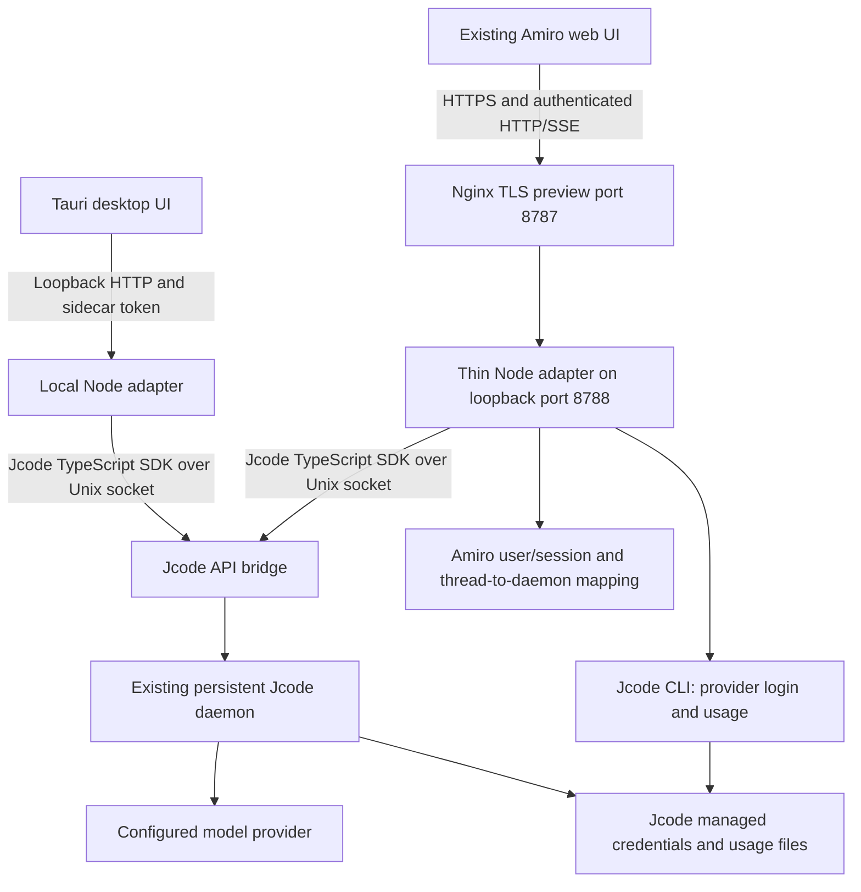

# Amiro runtime and preview

This is the current implementation guide. `amiro-on-jcode.md` is the earlier design proposal, not a deployment or completion report.

## Architecture



The adapter is transport, application authentication, and UI compatibility glue. It does not implement another agent reasoning loop. Jcode owns model execution, persisted session history, and model/provider routing. The old Go backend is removed from the active application.

Amiro is the product name. `bin/amiro` delegates to the upstream `jcode` CLI, not an uncredited fork. Jcode and `@1jehuang/jcode-sdk` retain their upstream identity and license attribution. The SDK used here is version 1.2.0, MIT licensed. The installed runtime used during verification is Jcode v0.95.0.

## Login

There are two different logins:

1. **Application sign-in:** a random initial owner password is generated into `$AMIRO_HOME/admin-initial-password`, a mode-0600 JSON file. There is no public default password. Registration is closed by default. An existing insecure `admin@local` account using the old `admin` default is rejected at startup, not reset.

   The owner may replace it with a shorter password through `PUT /api/user/password` (the UI profile flow uses the same route). This preview is owner-only, so that is the owner's choice; a short password on a publicly reachable admin account is a real risk. Compensating controls currently in place: sign-in is rate-limited to 15 attempts per 15 minutes per client address, registration is closed, and provider mutation is admin-only. Prefer a long password if the preview is left running unattended. A password change takes effect immediately and survives later logins.
2. **Provider connection:** use `/login` in the chat composer or the visible UI connection control. It opens a dedicated panel. API keys and authorization codes are never submitted as ordinary chat messages. OAuth starts a scriptable Jcode CLI flow, displays the provider authorization URL/device code, accepts callback/code input separately, and polls for completion. The CLI receives callback secrets over stdin, not process arguments. After successful login, the adapter notifies the daemon that authentication changed.

**Important scope:** this preview attaches to one owner's existing daemon and credential home. Provider credentials are shared runtime/operator credentials. Provider mutation is admin-only. This is NOT an isolated multi-tenant BYOK service. Enabling multiple untrusted users requires separate credential/daemon isolation and per-user provider selection before it is safe to call this production-ready.

The user's browser must complete real provider authorization. Tests can verify flow initiation/cancellation and errors without authorizing or replacing the owner's existing credentials. A passing frontend build is not proof that every provider completed OAuth.

## Providers

The provider panel lists every provider the installed Jcode supports, with its real mechanism, from `jcode provider list --json` joined with `jcode auth status --json` (`GET /api/providers/catalog`, cached 60s). Observed on this install: 55 providers, of which 5 are OAuth, 45 API key, 2 local endpoint, 1 device code, 1 CLI, plus the `auto` routing pseudo-provider. Each entry reports `connected`, `credentialSource`, `validation`, `lastRefresh`, `canStartOauth` and `canAcceptApiKey`; credential-looking values are redacted and key material is never returned or logged.

- **OAuth / device code** providers use the interactive flow (`/api/providers/:id/oauth/start|status|callback`), which surfaces the real provider URL or device code and never handles the user's password.
- **API key** providers are configured through `POST /api/providers/:id/api-key` (admin-only). The adapter writes the key with Jcode's own login path (`jcode login <provider> --no-validate` with the key on stdin, which stores `$JCODE_HOME/config/jcode/<provider>.env`; `openai-compatible` additionally takes `--api-base`), then confirms the provider flips to available and tells the daemon auth changed. `DELETE /api/providers/:id/credentials` removes it. A provider without an API-key mechanism is refused with an explicit error rather than silently doing nothing.
- The catalog is rebuilt as soon as any credential change is reported, so a newly connected provider's models are selectable immediately instead of after the refresh interval.

## Models

The model selector offers the models of every **connected** provider, taken from `jcode model list -p <provider> --json` per connected provider. Observed on this install: 140 models across openai (11), opencode-go (39), openai-compatible (71) and antigravity (19). Models are namespaced `provider:model`, which is the route-pinned form the bridge needs; a bare model name would fall back to the daemon's default endpoint.

Environment semantics:

- `AMIRO_DEFAULT_MODEL` (set to `opencode-go:deepseek-v4.1-flash` on this preview) selects the model an omitted-model request uses and makes that provider group and model appear first, so a fresh chat starts on a known-working route rather than whichever provider happens to sort first.
- `AMIRO_PINNED_MODELS` remains a hard allow-list when set: only those models are listed and anything else is rejected. It is unset on this preview so that all connected providers are usable.
- With neither set, the connected-provider catalog is the allow-list. A model outside it is rejected with an explicit `model not allowed` error; there is no silent provider fallback. If the catalog cannot be built, the request is not refused (the daemon still rejects unknown ids) and the failure is logged.
- A provider whose usage limit is exhausted still appears; the turn fails with the provider's own error. OpenAI on this account reached its 5-hour limit during testing, which is an account state, not an adapter behaviour.

## Folder selection (works from the web)

The workspace folder picker browses the **server's** filesystem over HTTP, so it works in a browser without a native OS dialog. `src/components/chat/folder-browser-dialog.tsx` calls `GET /api/fs/roots|browse|stat`; the old `showDirectoryPicker()`/`webkitdirectory` path (which only yields a bare folder name and cannot resolve to a server path) was removed.

Safety rules in `adapter/src/fsbrowse.mjs`:

- Allowed roots come from `AMIRO_BROWSE_ROOTS` (default `/root,/home,/srv,/opt,/var/www,/tmp`); absolute paths only.
- A deny list (exact and prefix) covers `/root/.jcode`, `/root/.amiro-preview`, `/root/.ssh`, `/root/.aws`, `/root/.config/jcode`, `/root/.gnupg`, `/etc/letsencrypt`, `/etc/ssl/private`, `/root/.secrets`. Denied paths are neither listed nor enterable, before and after `realpath`.
- Every request is realpath-resolved and re-checked for containment, so a symlink cannot escape an allowed root. Listing is capped at 500 entries and **never returns file contents**.
- `GET /api/fs/*` requires an authenticated session; anonymous requests are 401.

The chosen folder becomes the session's working directory: the chat request carries `workingDir` (also accepted as `projectDirectory`/`workspaceRoot`), it is validated with the same rules, and a rejected folder returns 403 instead of silently falling back. The directory is stored per thread and reported by `GET /api/thread/:id`. If the folder changes on a thread that already has a session, the adapter starts a new Jcode session for that thread pinned to the new directory (same thread id and ownership; the previous session id is retained as `previousSessionId` and archived), so the selection actually takes effect.

The daemon echoes the directory it actually used when a session is created, and the adapter checks it: a session that starts somewhere other than the selected folder fails the turn with `working_dir_mismatch` rather than running in the wrong place. `adapter/tests/cwd-daemon.mjs` proves this end to end by reading the directory the daemon recorded for the session (`listSessions`), not the adapter's own mapping.

## Restrictions

- The deployed preview defaults to `tools: { enabled: [] }`, reapplied to sessions before turns. Text chat works without giving the model server filesystem or shell access.
- Model configuration is operator-controlled: the selector offers the models of the connected providers, with `AMIRO_DEFAULT_MODEL` choosing the landing model and `AMIRO_PINNED_MODELS` (when set) acting as a hard allow-list. A model-route failure does not silently select a different provider.
- Browser-supplied tool/MCP lists cannot widen permissions.
- Search is not implemented or enabled.
- Background execution, legacy skill generation, checkpoint restore, MCP tool execution/authorization, and workflow execution are not enabled. They return explicit unsupported errors rather than fabricated success.
- Uploaded files use opaque, expiring capabilities, bounded sizes, validated storage paths, and download-only content types. Remote URL ingestion is disabled.
- Public application sign-in is rate-limited. Arbitrary cross-origin browser requests are rejected.

These restrictions are a safe preview policy, not an OS sandbox. Do not enable unrestricted tools for public users. Workspace-aware custom tool handlers and an actual sandbox are separate work.

## Usage page

Quotas are read from `jcode usage --json`. Account-level OpenAI OAuth token counts and known costs are read from Jcode's daily usage buckets. Model activity counts are available from its SQLite activity database, but that table does not provide per-model token/cost attribution.

The UI explicitly labels shared-provider-account scope and OpenAI-only token/cost coverage. It does not distribute account tokens across unrelated models or claim per-user billing. Missing provider billing is not equivalent to zero actual provider usage. Thread counts only cover the Amiro user's own mapped threads, not unrelated shared daemon sessions.

## Running locally

```sh
pnpm install
npm --prefix adapter ci
pnpm build
jcode --no-update api-bridge --api-socket /run/user/0/jcode-api.sock
JCODE_API_SOCKET=/run/user/0/jcode-api.sock pnpm start
```

The adapter defaults to loopback. Select the home, host, port, and bridge socket with `AMIRO_HOME`, `AMIRO_HOST`, `AMIRO_PORT`, and `JCODE_API_SOCKET`. Model selection is described above (`AMIRO_DEFAULT_MODEL`, `AMIRO_PINNED_MODELS`), and the folder picker's roots come from `AMIRO_BROWSE_ROOTS`. Bridge CLI startup flags alone do not select the model for newly created SDK sessions, so the adapter explicitly configures each session.

## Admin providers page

`/admin/providers` uses the same catalog. The add-provider menu (searchable, grouped by mechanism with per-provider connected state) lists every provider Jcode supports; it previously hardcoded six, which is why most providers could not be added. Selecting a provider opens the same `LoginPanel` preselected, so each kind gets its own correct flow: OAuth/device code, API key, or the honest "this backend does not expose that flow" message for CLI/local-endpoint. `openai-compatible`/custom gateways still route to `/admin/providers/create` for a base URL and model list.

## This machine's preview

- Public entry: `https://194.238.18.234:8787`.
- Typing the plain-HTTP form is handled: `http://194.238.18.234:8787` is answered with a 301 to the HTTPS URL (`error_page 497`), and `http://194.238.18.234:8000` redirects to the same HTTPS preview, so a mistyped scheme no longer shows an nginx 400 plain-HTTP-on-HTTPS-port error. Ports 80 and 443 remain dedicated to the existing Vellum site
- TLS uses a temporary self-signed IP certificate. The browser will show a certificate warning that must be accepted manually. A trusted certificate needs a DNS name pointing at this server; `certbot` here uses the nginx HTTP-01 authenticator, so adding an A record for a subdomain is enough to issue one. This is for testing, not production TLS.
- Node API: `127.0.0.1:8788`, not publicly bound.
- App data: `/root/.amiro-preview`, separate from any earlier development home.
- Initial sign-in email: `admin@local`. Read the generated password from `/root/.amiro-preview/admin-initial-password` on the server. Do not publish that file.
- Services: `amiro.service` and `amiro-bridge.service`.
- Dedicated API socket: `/run/user/0/amiro-preview-api.sock`, attached to the existing `/run/user/0/jcode.sock` daemon. The shared daemon is not replaced or restarted.
- Nginx configuration: `/etc/nginx/sites-available/amiro-preview`. Existing ports 80/443 and the Vellum site are unchanged.

```sh
systemctl status amiro amiro-bridge --no-pager
journalctl -u amiro -u amiro-bridge --since '10 minutes ago'
node --test adapter/test/usage.test.mjs
node adapter/test/live-smoke.mjs
```

`live-smoke.mjs` uses the real preview's credentials locally without printing them, invokes a small permitted-provider turn, verifies SSE and persisted history, and archives its test thread.

## Desktop limitation

The Tauri launch path is retargeted to the Node adapter. A launcher script is not a self-contained redistributed desktop backend. End-user installers still need a packaged Node runtime, adapter dependencies, Jcode installation/bridge lifecycle, and platform-specific launchers. A web preview being available does not prove a portable desktop installer works.

## Verification

Current observed checks and remaining limitations are recorded in `verification-amiro.md`. That report links the requirement-to-observation matrix (`requirement-traceability.md`) and the per-route auth/read observations (`route-observations.md`). Treat those reports, not older reconnaissance notes, as the completion evidence.
