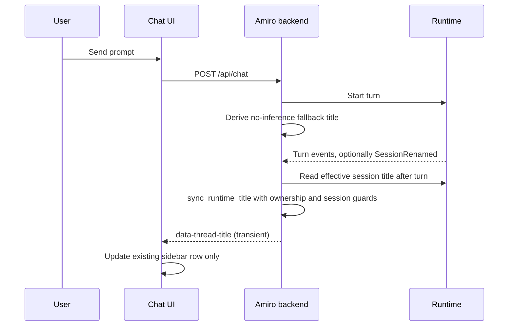

# Chat titles

Amiro reuses the owned runtime's effective session title for thread persistence
and the sidebar. The browser does not make a separate model call to name a chat.

This document describes the implementation in `f427457` and the runtime title
rules it depends on.

## Source of truth

Title ownership is split deliberately:

- The runtime generates the fallback title from the first visible user prompt.
- The runtime stores explicit renames as custom titles.
- The backend reads the runtime's effective title and mirrors it into the thread
  mapping.
- The frontend applies transient `data-thread-title` events to the existing
  sidebar row.

The runtime is the source of truth for the title text. The backend owns the
thread mapping, ownership, deletion, and manual title source.

## Prompt title derivation

Source: `runtime/crates/amiro-session-types/src/title.rs`.

`prompt_title` applies these rules:

1. Remove complete `<system-reminder>...</system-reminder>` blocks.
2. Remove `<transcription>` and `</transcription>` tags but keep the inner text.
3. Collapse all whitespace to single spaces and trim the result.
4. Return `None` for an empty result, a slash command starting with `/`, or a
   scheduled task prompt starting with `[Scheduled task]`.
5. Take at most 64 Unicode scalar values. When text remains, append `…`, so the
   displayed title is at most 65 characters.

Unbalanced wrapper tags are kept as ordinary text. The function does not call a
model.

Examples covered by the module tests:

- `"  help me   improve the session sidebar\nplease "` becomes
  `"help me improve the session sidebar please"`.
- `<transcription>Rename the sidebar rows.</transcription>` becomes
  `"Rename the sidebar rows."`.
- A `<system-reminder>` only prompt produces no title.
- `/model gpt-5`, `[Scheduled task]\nrun it`, and blank input produce no title.

## Runtime session title

Source: `runtime/crates/amiro-base/src/session.rs` and
`runtime/crates/amiro-base/src/session/persistence.rs`.

`Session::append_stored_message` calls `adopt_prompt_title` before appending each
message. It only adopts a title when all of these hold:

- the session has no title yet
- the message role is user
- the message is a visible conversation message
- a text block yields a prompt title

A visible conversation message has no display role, is not an internal
`<system-reminder>` message, and is not a scheduled task prompt. This prevents
background notifications and scheduler prompts from naming the conversation.

Sessions recorded before prompt titles existed are backfilled when loaded.
`backfill_prompt_title` finds the first visible user message and applies the same
rule.

At display time the effective persisted title prefers:

1. an explicit custom rename
2. a saved bookmark label, when the session is saved
3. a todo-derived title in persisted metadata
4. the generated or imported title

`SessionInfo.title` in `runtime/crates/amiro-harness-api/src/events.rs` is
documented as the effective persisted display title, with the custom rename
taking precedence. Runtime session listing and attach responses therefore carry
the title the user should see, not merely the generated fallback.

The session list index backfills legacy prompt titles in bounded work. It scans
newest first and stops after a 300 ms budget per list request, caching an empty
value to avoid rescanning a session with no usable prompt. A large legacy backlog
can therefore complete over several list calls.

## Backend mapping

Source: `backend/src/threads.rs` and `backend/src/chat.rs`.

### Thread record

A thread entry in `threads.json` keeps:

- `sessionId`: the runtime session the thread maps to
- `userId`: the owner
- `title`: the title shown by the API
- `titleSource`: `"runtime"` or `"manual"`

A legacy mapping without `titleSource` is treated as non-manual and can receive a
runtime title, but only when the ownership and session checks pass.

### First turn fallback

When a chat starts a new runtime session, the backend immediately patches the
thread with a fallback derived from the first user text:

```rust
patch["title"] = json!(derive_title(&user_text));
patch["titleSource"] = json!("runtime");
```

`derive_title` calls the shared runtime `prompt_title` function and falls back to
`"New Chat"` when there is no usable prompt. This is a no-inference fallback so
the sidebar has something to show before the runtime metadata is read.

### After the turn

The backend reads the runtime's effective title once after the turn:

```rust
runtime::session_title(&state, &session.session_id)
```

`runtime::session_title` attaches to the session to read metadata. Attaching does
not submit an inference turn. If the title is present, the backend calls
`threads::sync_runtime_title` and emits a transient SSE event:

```json
{"type":"data-thread-title","data":{"threadId":"...","title":"..."},"transient":true}
```

### Runtime rename event

During streaming, the runtime can emit `SessionRenamed`. The backend only acts
when the event's `session_id` matches the current turn's session. It syncs the
title and emits the same `data-thread-title` event. This covers runtime-initiated
renames that are not the final post-turn metadata read.

### Listing and reading threads

`GET /api/thread`:

- reads the thread map
- checks whether any owned thread is not manually titled
- if so, calls `runtime::session_titles`, which lists runtime sessions and maps
  each `session_id` to `SessionInfo.title`
- syncs each owned mapping whose session has a runtime title
- re-reads the map and returns owned threads only

This runtime lookup is best effort. A runtime failure does not fail the thread
list. Manual titles skip the lookup entirely.

`GET /api/thread/{id}`:

- requires an owned thread
- for a non-manual thread with a session, reads `runtime::session_title`
- syncs and returns the updated title when available
- then loads history from the runtime

### Manual rename

`PUT /api/thread/{id}` with a `title` string:

- stores the title
- sets `titleSource` to `"manual"`
- calls `runtime::rename_session`, which attaches to the session and renames it

Once marked manual, later runtime title syncs are ignored for that thread.

### Legacy title route

`POST /api/chat/title` still exists for compatibility. It returns the effective
title as an SSE text response.

It does not generate a title and it does not use the supplied `message`. The
message field is explicitly ignored because the runtime owns naming. It returns
`404` for a missing thread or a thread owned by another user. It does not create a
thread. If reading the runtime title fails, it emits a transient
`data-title-unavailable` event. The route performs no inference.

The frontend hook `useGenerateThreadTitle` still targets this route, but it is no
longer referenced by the chat UI. The current chat flow relies on
`data-thread-title` instead. The acceptance script asserts that the browser makes
zero `/api/chat/title` requests.

## Mapping guards

`sync_runtime_title` is the single write path for runtime-derived titles. It
returns `None` without writing when any guard fails:

- the trimmed title is empty
- the thread id no longer exists, so a late event cannot resurrect a deleted
  thread
- the thread is not owned by the requesting user, using fail-closed ownership
  where an ownerless mapping belongs to nobody
- the stored `sessionId` does not equal the title's session id, so a stale title
  from a previous session cannot overwrite the current mapping
- `titleSource` is `"manual"`, so a rename cannot be overwritten

When the title and source are already identical, it returns the title without a
write. Otherwise it sets `title` and `titleSource: "runtime"` under the store
lock and writes the thread map.

The frontend applies the SSE payload through
`src/lib/backend/runtime-thread-title.ts`. It rejects:

- a non-object payload
- a `threadId` that differs from the active thread
- a non-string title
- a blank title after trimming

On success it updates only the matching row in `threadList`. It never inserts a
row. If the user deleted the row, a late title event does not bring it back.

## Flow summary



## Verification

### Unit and integration tests

Backend mapping and route behavior:

```bash
cargo test --manifest-path backend/Cargo.toml --test runtime_titles
```

This covers ownership, missing threads, session mismatch, blank titles, manual
rename preservation, and a title endpoint that does not create threads or require
cosmetic inference.

Backend title fallback:

```bash
cargo test --manifest-path backend/Cargo.toml --lib title
```

Runtime title derivation:

```bash
cargo test --manifest-path runtime/Cargo.toml -p amiro-session-types title::tests
```

Frontend mapping guard:

```bash
./node_modules/.bin/vitest run src/lib/backend/runtime-thread-title.test.ts
```

This covers updating only the matching row, no duplicate rows, malformed and
mismatched payload rejection, blank titles, and no resurrection of a deleted row.

### Browser and backend acceptance

```bash
node scripts/verify-runtime-titles.mjs
```

The script starts a local OpenAI-compatible fixture provider, a temporary
`AMIRO_HOME` and runtime home, and the built backend and runtime binaries. It
then logs in as a fixture owner and drives Chromium.

It verifies:

- the real browser can send a chat message
- the runtime title is persisted with `titleSource: "runtime"`
- the sidebar shows that title
- the browser makes no `/api/chat/title` request
- the fixture provider receives exactly one chat inference request, with no
  cosmetic title turn
- a manual rename is preserved when `/api/chat/title` is called afterwards
- the manual title survives a page reload

The fixture provider and fixture key are local. No external provider is used.

### Limitations

- `verify-runtime-titles.mjs` proves local backend, runtime, and browser wiring
  against a deterministic fixture provider. It does not prove an external model
  provider behaves the same way.
- The test is not a concurrency test. The thread store serializes writes, but
  simultaneous renames, deletions, and late runtime events across multiple
  processes are not exercised.
- The script depends on the built debug binaries and Playwright Chromium. It
  creates a temporary home and best-effort cleans up the runtime processes it
  starts.
- Legacy backfill is bounded by a 300 ms budget per list call. A large backlog may
  require more than one list request before every old session shows a title.
- The title endpoint test confirms no cosmetic inference for the route. The
  browser acceptance script is the check that the current UI does not call that
  route.
